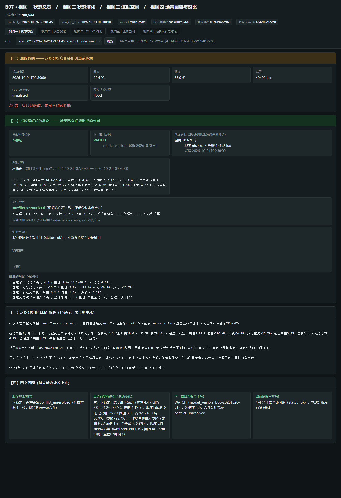
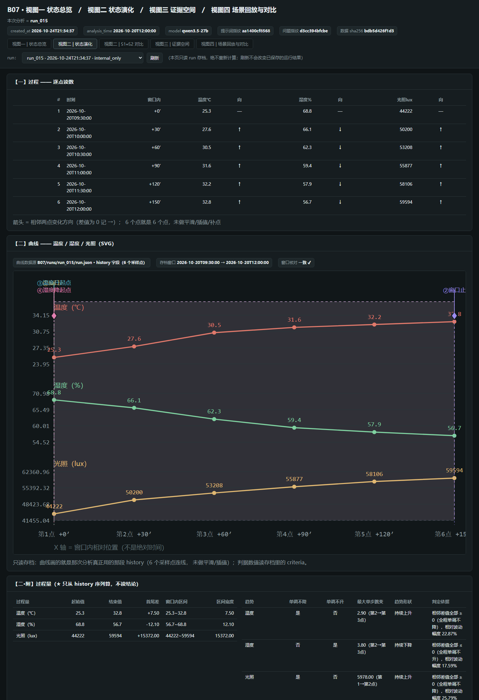
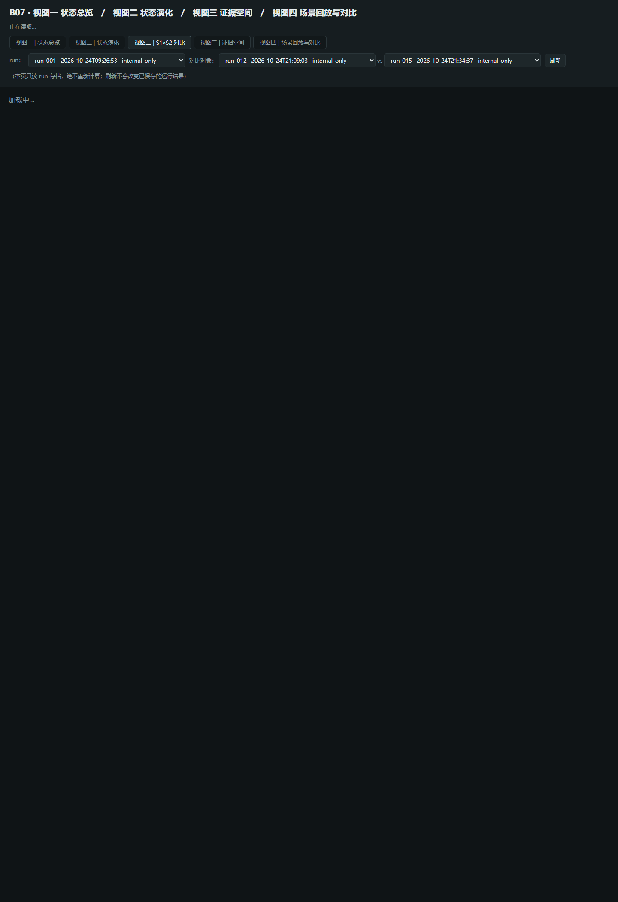
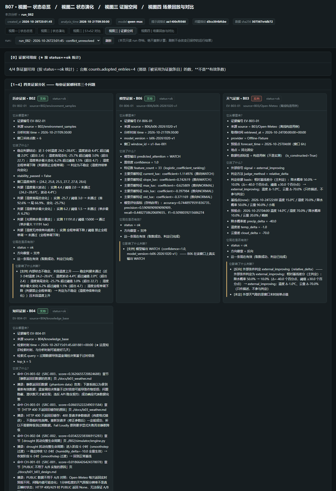
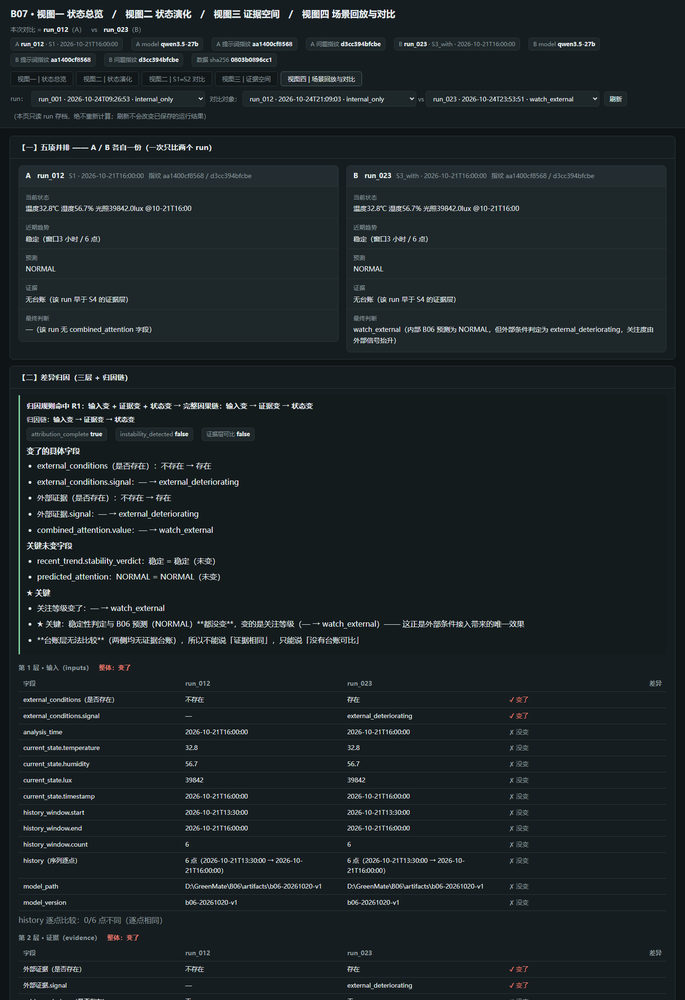

# GreenMate — 大棚环境监测系统

把【当前大棚状态 + 用户问题】一起发给 LLM，用**同题 A/B 对照**证明 AI 真的读到了当前状态；
同时把单点状态升级为可持久查询的 7 天时序数据，支持统计、变点检测和时间窗口预测。

> ⚠️ 所有传感器数值均为**模拟数据（SIMULATED）**，未接入任何真实硬件。

---

## 项目结构

```
GreenMate/
├── .gitignore
├── README.md              # 本文档
├── requirements.txt       # 统一依赖（pip install -r requirements.txt）
│
├── B01/                   # LLM 状态上下文对照
│   ├── main.py            # FastAPI：状态定义、页面路由、A/B 对照接口
│   ├── llm.py             # 提示词、状态注入、配置日志、异常翻译
│   ├── check_llm.py       # 独立验证 API Key / Base URL / 模型名
│   ├── verify_step5.py    # 故障注入验收脚本
│   ├── static/
│   │   └── index.html     # 页面：A/B 双面板、可编辑数值、Context 展开
│   ├── .env               # 密钥（已移至根目录，gitignore 排除）
│   └── venv/              # 已移除，统一使用根目录 venv/
│
├── B02/                   # 数据记忆：时序持久化 + 变点检测
│   ├── SPEC.py            # 字段规范 / 时间轴 / sim_scenario 使用限制
│   ├── simulator/
│   │   └── engine.py      # 7天 × 336点时序数据生成器（GreenhouseSimulator）
│   ├── database/
│   │   ├── store.py       # SQLite 持久化（建表 / 写入 / 校验）
│   │   └── generate.py    # 主程序入口（生成 + 写入 + 报告）
│   ├── api/
│   │   ├── history.py     # 直接调用，不过 HTTP
│   │   └── server.py      # FastAPI 时序查询服务（端口 8001）
│   ├── quality/
│   │   └── checker.py     # 6 项质量检查
│   ├── changepoint/
│   │   └── detector.py    # 变点监测算法
│   ├── static/
│   │   └── history.html   # Chart.js 时序曲线页面
│   ├── gen_sample.py      # 生成 20 条样本写入 env_data 表
│   ├── query_sample.py    # 查询 / 验证 env_data 表
│   ├── check_disturbance.py  # 查询扰动数据
│   ├── __init__.py
│   └── greenmate.db       # SQLite 数据库（已 commit，gitignore）
│
├── B03/                   # 气象 API 接入：外部环境证据 + 卡尔曼滤波
│   ├── SPEC.py            # API 文档 / 预置城市坐标 / WMO 天气代码
│   ├── weather.py         # 最小真实调用：打印 HTTP status + 原始 JSON
│   ├── weather_service.py # 主程序：PUBLIC/SIMULATED 对比 + 卡尔曼滤波 + 可视化
│   └── .env.example       # 配置模板（终端传参优先级高于此文件）
│
├── B04/                   # 检索增强知识库问答：带溯源引用的 RAG
│   ├── SPEC.py            # 知识库问题 / 可信资料 / 切片定义
│   ├── retrieve.py        # TF-IDF 向量检索（纯 Python，无需大模型 API）
│   ├── answer.py          # Step 5-6：回答生成 + 边界幻觉测试
│   └── __pycache__/       # Python 缓存（gitignore）
│
├── B05/                   # 工具调用编排器 + SoilGrids MCP
│   ├── orchestrator.py    # ReAct 流水线：参数验证 / 超时保护 / unavailable 重试
│   ├── tools.py           # OpenAI function-calling 工具定义（4 个工具）
│   ├── test_functions.py  # 四个底层业务函数测试（ok/unavailable/error 三态）
│   ├── test_connect_error.py   # 网络异常注入测试
│   ├── test_multi_tool.py      # 多工具任务验证（五步日志格式）
│   ├── test_orchestrator.py    # 编排器 ask() 主流程测试
│   ├── test_boundary.py        # 边界幻觉测试
│   ├── test_soilgrids.py       # SoilGrids MCP 五步 + Step 6 手动交互
│   ├── verify_weather_source.py # 气象数据源验证
│   └── run_all_b05.py     # 全量测试串行执行器
│
├── B06/                   # 实时窗口推理 + SHAP 贡献
│   ├── SPEC.py            # 时间窗口结构 + DTW 算法（纯 Python）
│   ├── config.py          # 特征白名单、标签阈值、DTW 配置
│   ├── generate.py        # 窗口构造 + trace CLI（WINDOW_SIZE=6 可配置）
│   ├── feature.py         # 33 特征提取（仅从 history 窗口）
│   ├── split.py           # 时间切分 + 泄漏自检（4 项检查）
│   ├── train.py           # 朴素基线 + LogisticRegression 训练评估
│   ├── persist/           # 模型持久化
│   │   ├── persist.py     # save_model / load_model（含一致性校验）
│   │   └── __main__.py    # CLI：save / load
│   └── inference/         # 实时推理
│       ├── inference.py   # predict_window / MODEL_OUTPUT / SHAP / DTW
│       └── __main__.py    # CLI：infer / verify
│
├── B07/                   # S1–S5：选窗 → 取数 → 推理 → 判断 → 解释 → 存档 → 阶段报告
│   ├── __init__.py        # 包声明（让 python -m B07.runs 能跑）
│   ├── __main__.py        # 入口分发：默认 S1 全流程，--scenario S1/S2，list/explain 透传给 runs
│   ├── config.py          # 位置 / 窗口点数 / 采样间隔 / gap 阈值 / 降级开关说明
│   ├── s1.py              # S1 统一入口 + 阶段报告生成
│   ├── s2.py              # S2 统一入口（渐进漂移）+ 阶段报告生成
│   ├── scenarios.py       # 场景注册表（S1/S2）：哪个场景用哪个选窗策略
│   ├── check_s2_experiment.py  # S2 实验有效性校验脚本（只读存档，9 条自检）
│   ├── stability.py       # 稳定窗口扫描 + 透明稳定判定规则
│   ├── evidence.py        # 当前状态 + 最近历史 + 时间锚点（含校验）
│   ├── predict.py         # 加载 B06 已存模型做一次预测
│   ├── knowledge.py       # S4-1：走 B05 search_tomato_knowledge 接 B04 知识库
│   ├── weather.py         # S3 天气接入层（B03 未来外部天气）+ S5 降级开关（唯一读开关处）
│   ├── evidence_registry.py  # S4-0：证据身份层（status 三态 / data / error 硬约束）
│   ├── evidence_ledger.py    # S4-2：台账 → 方向 → 分歧三列（supporting/opposing/undetermined）
│   ├── judgement.py       # 结构化判断五/六字段 + 合成关注等级（纯程序，无 LLM）
│   ├── explain.py         # LLM 解释 + 一致性校验（只解释，不判断）
│   ├── runs.py            # run 存档 + index 索引 + explain_run 回溯 + rebuild_index
│   │
│   ├── s3.py              # S3-2 单变量对照实验（真实组 / 离线组 / 降级验证）
│   ├── s3_report.py       # 从实测存档生成 s3_report.md
│   ├── s3_citation_probe.py   # 引用率探针（冻结 ⑥ 块重复跑，只测 LLM 采样波动）
│   ├── s3_citation_table.py   # 全部 S3_with 存档的统一判定表
│   ├── verify_s3.py       # S3 阶段验收自检（全部离线，不联网、不调 LLM）
│   │
│   ├── s4.py              # S4-2 分歧场景主入口（内部 WATCH × 外部转好）
│   ├── s4_windows.py      # S4-1：扫描 B06 输出 WATCH 的窗口，挑出 S4 锚点
│   ├── s4_offline.py      # S4-1：可复现的离线天气夹具（构造用例，非实测）
│   ├── s4_3.py            # S4-3 负面对照（平铺组 vs 分身份组）
│   ├── s4_3_detector.py   # S4-3 断言/归因检测器（复用 S3 判定思路）
│   ├── s4_report.py       # 由 s4_raw_result.json 生成 s4_report.md + model_table.md
│   │
│   ├── s5.py              # S5 证据退化实验（基线 n 次 + 降级 n 次）
│   ├── s5_probe.py        # S5 防伪造检验探针（A/B/C/D，复用 S3 的句子切分与元陈述判定）
│   ├── s5_report.py       # 由 s5_raw_result.json 生成 s5_report.md
│   ├── s5_show.py         # S5 一步到位展示（只读存档，不调 LLM）
│   │
│   ├── innovation1.py     # 创新点 1：连续时间认知消融（2 锚点 × 3 档 = 6 次 LLM）
│   ├── innovation2.py     # 创新点 2：可追溯证据的自动溯源器（只读 run 存档，0 次 LLM）
│   ├── innovation3.py     # 创新点 3：第二遍走查器（C1–C5 机器检查 + 12 节走查）
│   ├── verify_innovation2.py  # 创新点 2 的独立复核脚本（只读，不修改任何文件）
│   │
│   ├── views.py           # ★ 第三遍四视图的**数据层 + 终端渲染**（只读 run 存档，绝不重算）
│   │                      #   load_run / view_data / view_evolution_data /
│   │                      #   view_evidence_data / view_compare_data + 四个 render_*
│   ├── views_diff.py      # 视图四差异归因器（三层对比 inputs/evidence/state + R1~R6 规则）
│   ├── views_check.py     # 四视图统一检查（U1 身份一致 / U2 同源 sha256 / U3 零重算打桩 / U4 既有断言）
│   ├── replay.py          # ★ 视图四**回放器**：**唯一**允许发起新运行的地方（选场景 → 跑固定问题 → 新 run_id）
│   ├── views_web.py       # FastAPI 路由（视图一~四 + GET /api/compare?a=&b=），复用 views.py 的数据层
│   ├── static/            # Web 版静态页面（进版本库）
│   │   └── views.html     # 五个标签页（视图一/二/二·对比/三/四）；纯静态、离线可开、不引任何 CDN 外链
│   │
│   ├── tests/             # 不变量测试（pytest，共 331 项：S1–S5 169 + 创新点 1/2/3 90 + 第三遍视图 72）
│   │   ├── conftest.py    # 路径注入 + 假 LLM 客户端
│   │   ├── test_s1_invariants.py
│   │   ├── test_s2_invariants.py
│   │   ├── test_weather_invariants.py
│   │   ├── test_s3_invariants.py
│   │   ├── test_s4_invariants.py      # 44 项
│   │   ├── test_s4_3_invariants.py    # 15 项
│   │   ├── test_s5_invariants.py      # 17 项
│   │   ├── test_innovation1_invariants.py   # 28 项（连续时间认知消融不变量）
│   │   ├── test_innovation2_invariants.py   # 45 项（溯源形状 / 红线 / 台账自洽）
│   │   ├── test_innovation3_invariants.py   # 17 项（词表多字 / C2 / C4 豁免 / 确定性）
│   │   ├── test_views_invariants.py         # 14 项（同源 / 刷新不变 / 不重算 / 证据完整度）
│   │   ├── test_views_evolution.py          # 17 项（只读 history / 过程量不依赖结论 / C1–C5 / 对照 / 不许编造标记）
│   │   ├── test_views_evidence.py           # 15 项（只读存档 / 可用条数按 status==ok / 缺失可见 / 反抹平 / 无台账）
│   │   ├── test_views_compare.py            # 11 项（三层可复算 / R4 不稳定性必触发 / R2·R1 命中 / 干净对照 / U1–U4）
│   │   └── test_views_layout.py              # 15 项（版面顺序：单列自上而下 / 编号递增 / 面板内并列）
│   ├── runs/              # 运行时生成的 run 存档（**进版本库**：证据链的一部分）
│   │   ├── index.json     # 索引：run_id → 摘要
│   │   └── run_XXX/run.json
│   └── artifacts/         # 阶段报告（**进版本库**：报告数字全部来自这里的存档）
│       ├── s1_report.md
│       ├── s2_report.md
│       ├── s3_report.md
│       ├── s3_raw_result.json
│       ├── s3_offline_result.json
│       ├── s3_citation_stats.json
│       ├── s3_citation_table.json
│       ├── s3_frozen_ext.json
│       ├── s3_calibration.json
│       ├── s4_report.md
│       ├── s4_raw_result.json
│       ├── s4_3_contrast.json
│       ├── s5_report.md
│       ├── s5_raw_result.json
│       ├── model_table.md  # 跨阶段 LLM 模型对照表（由 s4_report.py 生成）
│       │
│       ├── innovation1_report.md            # 创新点 1 报告（消融结论 + 泄露判据）
│       ├── innovation1_runs.json            # 创新点 1 原始结果（6 次回答 + 量化指标）
│       ├── innovation1_baseline_contexts.json  # 创新点 1 回归基线（默认上下文逐字节对照）
│       ├── innovation2_report.md            # 创新点 2 报告（溯源链实录 + V1–V6 判定）
│       ├── innovation2_trace.json           # 创新点 2 溯源结果（规格固定格式）
│       ├── innovation2_trace_detail.json    # 创新点 2 溯源详版（判定依据 / 匹配信号）
│       ├── innovation3_report.md            # 创新点 3 走查报告（12 节 + C1–C5）
│       ├── innovation3_runs.json            # 创新点 3 三次运行结构化结果 + 检查项
│       ├── views_evolution_compare.md       # 视图二 S1↔S2 对比结果（C1–C5 实测值 + 曲线文本）
│       ├── views_evidence_report.md         # 视图三证据空间实测报告（C1–C14 + 三问清单 + Limitations）
│       ├── views_compare_report.md          # 视图四场景对比实测报告（4 组归因 + 三层明细 + U1–U4）
│       ├── replay_log.jsonl                 # 回放日志（另存；run.json 存档结构一字未改）
│       ├── views_web_01_overview.png        # ★ README 内嵌：视图一 状态总览 全景截图
│       ├── views_web_02_evolution.png       # ★ README 内嵌：视图二 状态演化 全景截图
│       ├── views_web_03_compare.png         # ★ README 内嵌：视图二 S1↔S2 对比 全景截图
│       ├── views_web_04_evidence.png        # ★ README 内嵌：视图三 证据空间 全景截图
│       └── views_web_05_view4.png           # ★ README 内嵌：视图四 场景回放与对比 全景截图
│                                           # （其余 views_*.png 是排障截图，.gitignore 忽略，不进版本库）
│
└── docs/                  # 项目设计文档
    ├── b01_b03_design.md  # SIMULATED/PUBLIC 数据源定义
    └── b03_weather.md     # HTTP 400 缓存策略 / Fail Loudly 设计
```

---

## 环境要求

- **Python 3.12**（开发验证于 3.12.7）
- 统一依赖安装：`pip install -r requirements.txt`
- B01 额外需要：一个 OpenAI 兼容的 LLM 服务（本项目用阿里云百炼 MaaS 工作空间）

---

## 快速开始

所有命令在 **项目根目录** `D:\GreenMate>` 下直接运行，无需 cd 进入子文件夹。

### 前置命令

**激活虚拟环境（Windows CMD）**
```cmd
D:\GreenMate> venv\Scripts\activate.bat
```

**清理端口占用（可选，端口被占时用）**
```cmd
:: 查端口占用
netstat -ano | findstr :8000
netstat -ano | findstr :8001

:: 杀进程（替换 <PID> 为实际进程号）
taskkill /F /PID <PID>
```

---

### B01 — LLM 状态上下文对照（端口 8000）

**1. 启动服务**

```cmd
D:\GreenMate> venv\Scripts\activate.bat
(venv) D:\GreenMate> python -m uvicorn B01.main:app --host 127.0.0.1 --port 8000
```

**启动成功标志：** `Uvicorn running on http://127.0.0.1:8000`

**浏览器访问：** <http://127.0.0.1:8000/>

**2. 配置 LLM（如未配置）**

编辑根目录 `.env` 文件：
```
LLM_API_KEY=sk-你的密钥
LLM_BASE_URL=https://<你的工作空间>.cn-beijing.maas.aliyuncs.com/compatible-mode/v1
LLM_MODEL=qwen3.5-27b
```

修改后需重启 B01 服务。

**3. 验证 LLM 配置**

```cmd
(venv) D:\GreenMate> python B01/check_llm.py
```

---

### B02 — 数据记忆（端口 8001）

**1. 生成 7 天时序数据（336 条）**

```cmd
(venv) D:\GreenMate> python B02/database/generate.py        # 如有旧数据则跳过
(venv) D:\GreenMate> python B02/database/generate.py --force  # 强制重刷
```

**2. 启动时序查询服务**

```cmd
(venv) D:\GreenMate> python -m uvicorn B02.api.server:app --host 127.0.0.1 --port 8001
```

**启动成功标志：** `Uvicorn running on http://127.0.0.1:8001`

**浏览器访问：** <http://127.0.0.1:8001/>

**3. 查询数据**

```cmd
:: 查看全部数据（environment_samples 表，336 条）
(venv) D:\GreenMate> python B02/check_disturbance.py

:: 查看最近 N 条
(venv) D:\GreenMate> python B02/query_sample.py --last 10

:: 查看全部（env_data 表，gen_sample 生成的）
(venv) D:\GreenMate> python B02/query_sample.py

:: 清空 env_data 表
(venv) D:\GreenMate> python B02/query_sample.py --clear

:: 质量检查（6 项全部 PASS 才可继续）
(venv) D:\GreenMate> python -m B02.quality.checker
```

**4. B07 接口（Python 代码调用，不过 HTTP）**

```python
import sys; sys.path.insert(0, 'D:/GreenMate')
from B02.api.history import get_current_environment, get_environment_history, query_stats
from datetime import datetime, timedelta

cur = get_current_environment()
print(cur.temperature, cur.humidity, cur.lux)

end = datetime.now()
start = end - timedelta(days=3)
samples = get_environment_history(start, end)
stats = query_stats(start, end)
print(stats["temperature"], stats["trend"])
```

---

### 常见报错

| 报错 | 原因 | 解决 |
|------|------|------|
| `ModuleNotFoundError` | 未激活 venv | 先运行 `venv\Scripts\activate.bat` |
| `Port already in use` | 端口被占 | 杀旧进程或换端口 `--port 8002` |
| 改了 `.env` 没生效 | 进程未重启 | 重启 B01 服务 |
| 页面空白/数据加载失败 | 服务未启动或缓存 | Ctrl+Shift+R 强制刷新，重启服务 |

---

## B01 核心链是怎么被证明的

A/B 对照是一次**控制变量实验**：

| 变量 | State A | State B |
|---|---|---|
| 用户问题 | 当前环境怎么样？ | **完全相同** |
| System Prompt | 同一份 | **完全相同** |
| 模型 / 温度 / 参数 | 相同 | **相同** |
| **注入的当前状态** | 24°C / 65% / 12000lux | 36°C / 35% / 22000lux ← **唯一变量** |

因为唯一的差异是状态，两次回答的差异**只可能**来自状态。

> 如果状态变了回答却基本不变，**先检查 Context 有没有真的更新**（展开「本次注入的 Context」看），而不是先去改 Prompt。

---

## B02 时间轴与数据规格

| 参数 | 值 |
|---|---|
| 采样间隔 | 30 分钟 |
| 时间范围 | 7 天 |
| 采样点数 | 336 |
| 扰动片段 | 5 段，分散分布在前/后半段 |
| 重启后数据 | 不丢失（SQLite WAL 模式）|

### 数据库字段

表：`environment_samples`

| 字段 | 类型 | 说明 |
|---|---|---|
| id | INTEGER | 主键，自增 |
| timestamp | DATETIME | ISO 8601，精确到秒 |
| temperature | REAL | °C |
| humidity | REAL | % |
| lux | REAL | lux |
| source_type | TEXT | 当前固定为 `simulated` |
| sim_scenario | TEXT | 场景名（**见下方限制**）|

### sim_scenario 使用限制（重要）

`sim_scenario` 是**模拟器内部元数据**，不是真实农情标签：

- **禁止**作为"正常/异常"标签用于模型训练或业务决策
- **允许**调试追溯、回归验证、二次标注（人工审核后替换）

**原因**：模拟器的"heat_wave"在某些作物某些时段恰恰是正常农情，不能直接映射为异常。
真实标签应由 B06 阶段由农业专家构造。

### 扰动片段清单

| 场景 | 持续时长 | 进入/恢复 | 主要数值偏移 |
|---|---|---|---|
| heat_wave | 18 小时 | 各 4 小时 | 温度 +12°C，湿度 -25% |
| drought | 24 小时 | 各 6 小时 | 温度 +6°C，湿度 -30% |
| shade | 12 小时 | 各 3 小时 | 光照 -40000 lux |
| cold_snap | 20 小时 | 各 5 小时 | 温度 -10°C，湿度 +15% |
| flood | 16 小时 | 各 4 小时 | 湿度 +20%，光照 -25000 lux |

---

## 变点监测算法（创新点，B02）

**输入**：温度时序序列
**输出**：状态突变时间点列表（ChangePoint）

**算法**：局部自适应阈值

1. 取 12 点（约 6 小时）滚动窗口
2. 计算窗口内温度均值 `μ` 和标准差 `σ`
3. 当前温度偏离 `μ` 超过 `max(2°C, 2σ)` → 触发变点
4. 两次变点至少间隔 16 点（约 8 小时）

```python
from changepoint.detector import detect_changepoints
from database.store import all_samples

cps = detect_changepoints(all_samples())
for cp in cps:
    print(f"{cp.timestamp}  ΔT={cp.delta_temp:+.1f}°C  场景={cp.new_scenario}")
```

**局限性**：
- cold_snap 等弱扰动（偏差峰值 -5°C）可能漏检
- 昼夜正常升温/降温也被捕捉（属正常生理现象，非误报）
- 评估基准是 sim_scenario 切换点，两者定义不同，不宜直接度量算法准确率

**用途**：为 B06 提供窗口边界候选，人工审核后确定最终标签。

---

## B06 如何复用 B02 数据

每个训练样本 = 一个时间窗口 + 标签。

```python
from api.history import get_environment_history
from changepoint.detector import detect_changepoints

cps = detect_changepoints()   # 变点 = 窗口边界候选
# 取每个变点前后各 WINDOW_SIZE 个样本构成窗口
# 标签由专家根据窗口内场景分布判定（不是直接用 sim_scenario）
```

---

## B08 回归验证要点

- **时间线可复现**：种子固定为 42，同一 seed 产生同一 336 点序列
- **扰动分散**：前半段（0-168 点）有 heat_wave/drought/shade，后半段有 cold_snap/flood
- **重启数据不丢**：数据库已 commit，关闭再打开数据完整
- **变点边界稳定**：用同一算法重跑应得到相同变点列表

---

## 常见问题

### 改了 `.env` 但完全没生效

**两个原因：**

1. **没保存**。看编辑器标签页：小圆点 `●` = 未保存，`×` = 已保存。最硬确认方式是看**文件大小变了没**。
2. **没重启服务**。`.env` 只在进程启动时读一次，之后改文件对运行中的进程毫无影响。

### 端口被占

```bash
netstat -ano | findstr :8000
taskkill //F //PID <PID>
```

### 中文日志乱码

`main.py` 顶部已加 `sys.stdout.reconfigure(encoding="utf-8", errors="replace")`。

### 页面改了但浏览器还是旧的

HTML 响应已带 `Cache-Control: no-cache`，仍不对就 **Ctrl+Shift+R** 强制刷新。

---

## 已知限制

1. **数据是模拟的**。没有真实传感器，`SIMULATED` 标注在页面上到处都有。
2. **A/B 机制证明的是「模型读到了状态」，不是「模型判断正确」**。机制有效，不保证农业判断准确。
3. **sim_scenario 不是真实农情标签**，不能直接用于业务决策。
4. **变点算法依赖温度信号**：cold_snap 等弱扰动可能漏检。
5. **无并发控制**：API 层无流量限制，不适合生产环境直接暴露。
6. **B02 无增量更新**：新数据只能全量重刷或手动 append，不支持实时流写入。
7. **B01 和 B02 暂无关联**：两者独立运行，数据不互通，未来计划由 B01 向 B02 写入实时状态。
8. **B03 Open-Meteo 数据为预报非实测**：降水概率等字段为概率预测，夜间太阳辐射为 0，非测量值。

---

## B04 — 检索增强知识库问答

实现带溯源引用的 RAG（Retrieval-Augmented Generation）。

**运行命令**

```cmd
(venv) D:\GreenMate> python B04/answer.py
```

**测试用例**

| ID | 类型 | 说明 |
|----|------|------|
| KB-001 | 业务问答 | SIMULATED 与 PUBLIC 数据源的本质区别，A/B 实验选取规则 |
| KB-002 | 业务问答 | drought 的 humidity_delta 偏移量及服务重启要求 |
| KB-003 | 业务问答 | HTTP 400 不返回旧缓存的原因及 Fail Loudly 原则 |
| KB-004 | 边界幻觉测试 | 告警音频文件名（知识库不存在，模型拒绝编造） |
| KB-005 | 边界幻觉测试 | PWM 工作频率（知识库不存在，模型拒绝编造） |

**技术方案**

- 向量检索：TF-IDF + cosine similarity（纯 Python，无需大模型 API）
- 知识库来源：项目文档切片（docs/ + 源码），元数据包含 source_id / section / page
- 引用约束：回答仅可使用本次检索命中的 chunk_id，禁止编造来源

---

## B05 — 工具调用编排器 + SoilGrids MCP

ReAct 风格的 LLM 工具编排流水线，支持多工具串联调用与失败验证。

**运行命令**

```cmd
(venv) D:\GreenMate> python B05/run_all_b05.py        # 全量测试串行执行
(venv) D:\GreenMate> python B05/test_soilgrids.py     # 单独运行 SoilGrids Step 6 手动交互
```

**核心模块**

| 文件 | 说明 |
|------|------|
| `orchestrator.py` | 编排器主流程：ReAct loop、Schema 验证、超时保护、unavailable 重试 |
| `tools.py` | OpenAI function-calling 工具定义（4 个底层工具） |
| `test_functions.py` | 四个底层业务函数（ok/unavailable/error 三态） |
| `test_connect_error.py` | 网络异常注入测试 |
| `test_multi_tool.py` | 多工具任务验证（五步日志格式） |
| `test_orchestrator.py` | 编排器 ask() 主流程测试 |
| `test_boundary.py` | 边界幻觉测试 |
| `test_soilgrids.py` | SoilGrids MCP 五步 + Step 6 失败验证与手动交互 |
| `run_all_b05.py` | 全量测试串行执行器 |

**编排器架构（orchestrator.py 重构）**

- **参数验证**：`validate_tool_args()` 解析 TOOLS schema，LLM 参数错误返回明确错误信息，不静默失败
- **超时保护**：`_exec_with_timeout()` 线程包装器，10s 超时强制终止
- **unavailable 重试**：工具返回 `status: "unavailable"` 时自动重试一次
- **max_turns 耗尽保护**：返回已执行工具摘要，而非静态字符串

**四步流水线**

1. 用户输入自然语言任务（禁止硬编码工具顺序）
2. LLM 判断调用哪个工具、传什么参数（`tool_choice="auto"`）
3. 后端解析 tool call → Schema 验证 → 超时保护执行 → unavailable 重试 → 返回真实结果
4. 结果注入消息上下文，LLM 生成最终回答

**工具清单（tools.py）**

| 工具名 | 功能 | 数据来源 |
|--------|------|---------|
| `get_current_environment` | 最新环境样本 | B02 SQLite |
| `get_environment_history` | 最近 N 小时时序 | B02 SQLite |
| `get_weather_forecast` | 天气预报 | Open-Meteo API |
| `search_tomato_knowledge` | 番茄知识库检索 | B04 TF-IDF |

**外部 MCP 接入（Step 5）**

SoilGrids MCP（`https://gateway.pipeworx.io/soilgrids/mcp`）补齐土壤数据缺口：

| 工具名 | 功能 |
|--------|------|
| `soil_properties` | pH / 有机碳 / 黏粒 / 砂粒 / 含水量 |
| `soil_classification` | FAO/WRB 世界土壤分类 |
| `list_soil_properties` | 可用属性列表 |

串联路径：`Open-Meteo(气象) + SoilGrids(土壤) → 精准灌溉策略`

**Step 6 失败验证（三类证据）**

| 场景 | 触发方式 | 证据 |
|------|---------|------|
| 参数错误 | latitude=999 | error="latitude must be between -90 and 90" |
| 超时 | timeout=0.001s | error="tool execution timeout after Xs" |
| 空结果 | 海洋坐标 | properties 全为 null |

## B03 — 天气 API 接入

接入 Open-Meteo 免费天气 API，获取真实外部环境证据。

**1. 运行命令**

```cmd
(venv) D:\GreenMate> python B03/weather_service.py
```

**2. 运行命令（卡尔曼滤波 + 可视化）**

```cmd
(venv) D:\GreenMate> python B03/weather_service.py
```

**3. B01 接入（通过 API）**

```cmd
(venv) D:\GreenMate> curl -X POST http://127.0.0.1:8000/api/weather/current -H "Content-Type: application/json" -d "{\"location\":\"北京大兴\",\"forecast_window\":\"now\"}"
```

**参数变更验证步骤**

| 测试 | 变更参数 | 预期结果 |
|------|---------|---------|
| 测试A | location=南京, forecast_window=6h | 返回多条 hourly 预报记录 |
| 测试B | location=(32.06, 118.79) 元组 | 按经纬度查询，数据与北京不同 |
| 失败验证 | latitude=999 | HTTP 400，系统拒绝返回旧缓存 |

**B03 功能清单**

| 功能 | 说明 |
|------|------|
| WeatherEvidence 结构 | temperature / humidity / precipitation_probability / cloud_cover / solar_radiation |
| 两类数据源 | PUBLIC（Open-Meteo）+ SIMULATED（B02 本地模拟） |
| 卡尔曼滤波 | 1D 卡尔曼滤波平滑温度时序，抖动抑制率 ~40% |
| 可视化 | matplotlib 对比曲线：蓝色原始预报 vs 红色滤波后 |
| 失败可观测 | HTTP 400/429/timeout 触发时返回值 None，无静默降级 |
| LLM 上下文 | format_state() 自动区分 PUBLIC 和 SIMULATED 来源 |

---

## 开发进度

| 模块 | 状态 |
|---|---|
| B01 — LLM 状态上下文对照 | ✅ 完成 |
| B02 — 数据记忆：时序持久化 + 变点检测 | ✅ 完成 |
| B03 — 天气 API 接入 + 卡尔曼滤波 | ✅ 完成 |
| B05 — 工具调用编排器 + SoilGrids MCP | ✅ 完成 |
| B04 — 检索增强知识库问答 | ✅ 完成 |
| B06 — 实时窗口推理 + SHAP 贡献 | ✅ 完成 |
| B07 — S1 稳态基线：选窗 → 取数 → 推理 → 判断 → 解释 → 存档 | ✅ 完成 |
| B07 — S2 渐进漂移：同一流程，只换历史窗口 | ✅ 完成 |
| B07 — S3 天气证据接入层：接 B03 未来外部天气（走 B05 工具接口） | ✅ 完成 |
| B07 — S4 证据身份层与证据分歧：证据有身份、方向由程序规则判定、分歧结构化 | ✅ 完成 |
| B07 — S5 证据退化：一次只弄坏一条证据，看系统还剩什么 | ✅ 完成 |
| B07 — 创新点 1：连续时间认知消融（拿掉 → 恢复 → 比较） | ✅ 完成 |
| B07 — 创新点 2：可追溯证据的自动溯源器（结论句反查工具调用） | ✅ 完成 |
| B07 — 创新点 3：让系统学会"有些话现在不能说"（C1–C5 机器检查 + 12 节走查） | ✅ 完成 |
| B07 — 第三遍 · 视图一 状态总览（只读 run 存档，零重算） | ✅ 完成 |
| B07 — 第三遍 · 视图二 状态演化（history 逐点 + 纯 SVG 曲线 + 相对时间轴） | ✅ 完成 |
| B07 — 第三遍 · 视图三 证据空间（台账三问 + 三色方向徽章 + 缺失可见） | ✅ 完成 |
| B07 — 第三遍 · 视图四 场景回放与对比（回放器 + 三层差异归因 R1~R6） | ✅ 完成 |
| B07 — 第三遍 · 四视图统一检查（U1 身份 / U2 同源 / U3 零重算 / U4 回归） | ✅ 完成 |
| B07 — 第三遍 · Web 版（五个标签页，纯静态离线可开，不引 CDN） | ✅ 完成 |

---

## B06 — 实时窗口推理

基于 B02 时序数据和 B06 训练好的 LogisticRegression 模型，对实时窗口进行推理，输出预测结果和 SHAP 特征贡献。

**运行命令**

```cmd
(venv) D:\GreenMate> python B06/inference/inference.py infer --model B06/artifacts/b06-20261020-v1
(venv) D:\GreenMate> python B06/inference/inference.py verify --model B06/artifacts/b06-20261020-v1
(venv) D:\GreenMate> python B06/persist/persist.py save --model B06/artifacts/b06-20261020-v1
(venv) D:\GreenMate> python B06/persist/persist.py load --model B06/artifacts/b06-20261020-v1
```

**核心模块**

| 文件 | 说明 |
|------|------|
| `inference/inference.py` | 核心推理模块：DTW + 特征提取 + LR推理 + SHAP 贡献 |
| `inference/__main__.py` | CLI 入口 |
| `persist/persist.py` | 模型保存与重载（含一致性校验） |
| `SPEC.py` | 时间窗口结构 + DTW 算法 |
| `config.py` | 特征列白名单、标签阈值、DTW 配置 |
| `feature.py` | 33 特征提取（仅从 history 窗口） |
| `split.py` | 时间切分 + 泄漏自检 |
| `train.py` | 朴素基线 + LogisticRegression 训练评估 |

**验证说明**

- `infer`：执行正常窗口推理，从 B02 最新样本构造实时窗口，输出 MODEL_OUTPUT（predicted_attention、confidence、SHAP Top-5、DTW 值、33 特征值）
- `verify`：执行失败验证，包含参数错误、超时、空结果三个场景，输出完整 tool_call / execute / 原始返回报文证据

**MODEL_OUTPUT 结构**

```
predicted_attention: NORMAL / WATCH
confidence: float（概率值）
model_version: b06-YYYYMMDD-vN
shap.top5_contributions: [{feature, contribution}, ...]
dtw_temperature / dtw_humidity / dtw_lux: float
raw_features: {特征名: 值}（33 个）
errors: [异常记录]（容错收集）
```

---

## B07 — S1 稳态基线

B07 的 S1 阶段做一件事：**用「当前状态 + 最近历史 + 已保存的 B06 模型」回答一个固定问题，并且把整个过程存档，让事后能复算、能回溯。**

流程严格按序，判断与解释分离：

```
选稳定窗口 → 取数（当前状态 + 最近历史 + 时间锚点） → 加载 B06 模型推理
   → 结构化判断（纯程序，无 LLM） → LLM 解释（只解释，不判断） → 落 run 存档
```

**依赖**

- Python 3.12 + `requirements.txt`（需 `scikit-learn`、`numpy`、`joblib`、`openai`、`python-dotenv`）
- B06 模型产物必须已存在：`B06/artifacts/b06-20261020-v1/`（`b06-20261020-v1.joblib` + `.json` 清单）
- B02 数据库 `B02/greenmate.db`（原始样本，只读）
- 一个 OpenAI 兼容的 LLM 服务（复用 `B01/.env`；`import B01.llm` 会自动加载）
- 测试额外需要 `pytest`：`pip install pytest`

**运行命令**

```cmd
(venv) D:\GreenMate> python -m B07.s1 --question "分析当前番茄生长环境状态以及接下来值得关注的变化，并说明判断依据。"

(venv) D:\GreenMate> python -m B07 list
(venv) D:\GreenMate> python -m B07 explain run_001
(venv) D:\GreenMate> python -m B07.runs list
(venv) D:\GreenMate> python -m B07.runs explain run_001

(venv) D:\GreenMate> python -m pytest B07/tests -v
```

> `--question` 必须是 S1-4 定的固定问题，改写会被直接拒绝（退出码 2）：LLM 解释环节用的就是这个问题，换问法会让存档里的 `question` 与实际提问不一致，事后回溯失真。
> `python -m B07`（不带子命令）等价于 `python -m B07.s1`。

**预期输出**

```
[1/6] 选稳定窗口...
  候选稳定窗口 51 个（白天段 27 个）
  选中窗口：2026-10-21T13:30:00 → 2026-10-21T16:00:00
[2/6] 取数（当前状态 + 最近历史 + 时间锚点）...
  当前状态：32.8℃ / 56.7% / 39842.0 lux @ 2026-10-21T16:00:00
[3/6] 加载 B06 模型推理...
  predicted_attention=NORMAL，confidence=1.0，model_version=b06-20261020-v1
[4/6] 结构化判断（纯程序，无 LLM）...
  复算自检：✅ 逐字段一致
[5/6] LLM 解释（只解释，不判断）...
[6/6] 一致性校验（只记录，不修改）...

【run_id】run_005
【结构化判断五字段】
  ① current_environment / ② recent_trend / ③ predicted_attention
  ④ evidence_status / ⑤ limitations
【LLM 解释】
  ...
【阶段报告】D:\GreenMate\B07\artifacts\s1_report.md
```

**产物清单**

| 路径 | 内容 | 是否入库 |
|---|---|---|
| `B07/stability.py` | 稳定窗口扫描 + 透明稳定判定（5 条判据，阈值写在模块顶部） | ✅ |
| `B07/evidence.py` | 当前状态 + 最近历史 + 时间锚点，6 项校验不通过直接抛错 | ✅ |
| `B07/predict.py` | 只加载 B06 已存模型做一次预测（不重训、不重切数据） | ✅ |
| `B07/judgement.py` | 结构化判断五字段，可脱离 LLM 复算（`recompute_judgement`） | ✅ |
| `B07/explain.py` | LLM 解释 + 结论冲突 / 事实越界一致性校验 | ✅ |
| `B07/runs.py` | run 存档、index 索引、`explain_run` 回溯、`rebuild_index` | ✅ |
| `B07/s1.py` | S1 统一入口 + 阶段报告生成 | ✅ |
| `B07/s2.py` | S2 统一入口（渐进漂移，只做编排）+ 6 条自检 + 阶段报告 | ✅ |
| `B07/scenarios.py` | 场景注册表（S1 / S2） | ✅ |
| `B07/tests/` | S1 + S2 + S3 不变量测试（68 条，pytest） | ✅ |
| `B07/runs/index.json` | 索引：run_id → {created_at, scenario, question, verdict, model_version, status} | ❌ gitignore |
| `B07/runs/<run_id>/run.json` | 单次运行完整快照 | ❌ gitignore |
| `B07/artifacts/s1_report.md` | 阶段报告（run_id / 证据来源 / 判据 / 五字段 / coef Top5 / LLM 原文 / 回溯输出） | ✅ |
| `B07/artifacts/s2_report.md` | S2 阶段报告（S1/S2 并排对比 / 实验有效性证明 / 温度带约定 / 边界与局限） | ✅ |

> `B07/runs/*.json` 命中 `.gitignore` 的全局 `*.json` 规则，属于运行时产物，不入库；需要留档请自行备份该目录。

**留下什么资产**

- `B07/stability.py` — 稳定判据（温度波动 ≤2.0℃ / 湿度首尾 ≤3.0% / 湿度单步 ≤1.5% / 光照跳变 ≤15000 lux / 禁全程单调），判定结论带具体数值，可被人复述
- `B07/evidence.py` — 时间锚点取法与 6 项证据校验（点数、间隔、末点对齐、source_type 透传、hours_gap 计算）
- `B07/predict.py` — B06 模型的推理入口与 meta 一致性校验（不通过直接中止，不静默继续）
- `B07/judgement.py` — 结构化判断五字段规范，含 4 条从真实数据算出的 limitations
- `B07/explain.py` — LLM 解释环节与一致性校验（只记录 warning，不改判断）
- `B07/runs.py` — run 存档、索引、失败留痕、`explain_run` 回溯（复算而非复读）
- `B07/runs/` — 每次运行的完整快照与索引（本地留存）
- `B07/artifacts/s1_report.md` — 本阶段报告
- `B07/artifacts/s2_report.md` — S2 阶段报告（渐进漂移的对比证据）
- `B07/tests/` — 68 条不变量测试（S1 24 + S2 26 + S3 18），全部离线可跑（LLM 用假客户端、天气用假工具）

---

## B07 — S2 渐进漂移

S2 与 S1 **共用同一套流程、同一个固定问题、同一个 system prompt、同一个模型、同一套判据阈值**，
唯一不同的是**看哪一段历史**。所以 S1 与 S2 的输出可以直接横向比较。

> **S2 只改变历史过程，不新增任何模块。**
> 没接 B03 天气、没接 B04 知识库、没改 B01/B02/B05/B06 任何文件、没重训模型、没重切数据、没动 B02 数据库。
> 新增的只有 B07 内部三样东西：`B07/scenarios.py`（场景注册表）、
> `B07/s2.py`（S2 入口，只做编排，逻辑全部复用 `B07.runs.run_analysis()`）、
> 以及 `B07/stability.py` 里的选窗策略 `pick_drifting_window()`。
> 判据阈值、提示词文字、固定问题、模型产物一个字没改。

| | S1 稳态基线 | S2 渐进漂移 |
|---|---|---|
| `anchor_policy` | `stable_window` | `drifting_comparable_to_S1` |
| `expect_stability` | `True` | `False`（必须判为不稳定） |
| 固定问题 | 与 S2 同一个字符串对象，一字不改 | 同左 |
| 判据阈值 | 不变 | 不变 |
| 选中窗口 | 2026-10-21T13:30 → 16:00 | 2026-10-20T09:30 → 12:00 |
| 末点温度 | 32.8℃ | 32.8℃（与 S1 差 0.0℃，当前值可比） |
| ΔT | 0.8℃ | 7.5℃ |
| 稳定判定 | 稳定 | **不稳定（持续升温）** |
| B06 预测 | NORMAL | NORMAL（预期，见下） |

**S1 / S2 对照结论**

两次的**当前值几乎一样**（温度都是 32.8℃、湿度都是 56.7%，差 0.0℃），
**提示词也完全一样**（`system_prompt_sha256` = `aa1400cf8568`，
`question_sha256` = `d3cc394bfcbe`，两次完全相同），
**唯一的差别是喂进去的那 6 个历史点**：

- S1：33.9 → 34.1 → 34.0 → 33.9 → 33.3 → 32.8℃（在平台上缓降，判为**稳定**）
- S2：25.3 → 27.6 → 30.5 → 31.6 → 32.2 → 32.8℃（单调升温，判为**不稳定**）

**同一个 32.8℃，在 S1 是「稳态平台的最后一点」，在 S2 是「持续升温过程的最后一点」。**
GreenMate 判的是"当前值 + 历史过程"，不是当前值本身——这就是 S2 想证明的事。
完整证据见 `B07/artifacts/s2_report.md` 第 7~9 节。

**选窗策略 `drifting_comparable_to_S1`（实现在 `B07/stability.pick_drifting_window`）**

在全部 331 个连续 6 点窗口里，同时满足下面三条的才算候选，再取 ΔT 最大的：

- (a) 末点温度落在 S1 参考带 `[32.8, 33.6]℃`（S1 末点 32.8℃，容差 0.8℃，单侧带：末点须已达到 S1 水平）
- (b) 窗口内温度**全程单调上升**
- (c) `judge_stability` 判定为**不稳定**

选窗时数据先被投影成只含 `timestamp / temperature / humidity / lux` 的行，
`sim_scenario` 字段在这一步被物理丢弃——**想用也用不上**。
选窗后还会跑一次对抗性自检：把 `sim_scenario` 全改成 `"XXXXXXXX"` 重跑选窗，结果必须完全一样。
选中的窗口恰好跨了 `cold_snap → normal` 的场景边界，这正是"没偷看 sim_scenario"的证据。

**入口**

```cmd
(venv) D:\GreenMate> python -m B07.s2
(venv) D:\GreenMate> python -m B07 --scenario S2
(venv) D:\GreenMate> python -m B07 --scenario S1        # 等价于 python -m B07.s1
(venv) D:\GreenMate> python -m B07 --scenario S3        # 未知场景 → 报错退出（退出码 2）

(venv) D:\GreenMate> python -m B07.s2 --report-only     # 只按已有存档重建 s2_report.md（不新增 run）
(venv) D:\GreenMate> python B07\check_s2_experiment.py --s1 run_012 --s2 run_015
(venv) D:\GreenMate> python -m B07.runs rebuild-index   # 按实际存在的存档重建 index.json
(venv) D:\GreenMate> python -m B07.runs explain run_014
(venv) D:\GreenMate> python -m B07 list
(venv) D:\GreenMate> python -m pytest B07/tests -v
```

> `--question` 同样必须是固定问题，改写直接被拒（退出码 2）。
> `--scenario` 只在跑全流程时生效；`list / explain / run` 仍是 B07.runs 的子命令。

**提示词指纹**

`llm_meta` 里新增两个字段，S1 / S2 存档可以直接比对"是不是同一套提示词、同一个问题"：

| 字段 | 值（当前） |
|---|---|
| `system_prompt_sha256` | `aa1400cf8568`（= `sha256(SYSTEM_PROMPT)[:12]`） |
| `question_sha256` | `d3cc394bfcbe`（= `sha256(FIXED_QUESTION)[:12]`） |

SYSTEM_PROMPT 文字本身一个字没动。

**实际输出（run_014）**

```
选中窗口：2026-10-20T09:30:00 → 2026-10-20T12:00:00
  25.3℃/68.8%/44222 → 27.6℃/66.1%/50200 → 30.5℃/62.3%/53208
  → 31.6℃/59.4%/55877 → 32.2℃/57.9%/58106 → 32.8℃/56.7%/59594

逐条判据
  ❌ 温度最大波动     实测 7.5  阈值 2.0     超出 5.5
  ❌ 湿度首尾总变化   实测 -12.1  阈值 3.0    超出 9.1
  ❌ 湿度单步最大变化 实测 3.8  阈值 1.5     超出 2.3
  ✅ 光照单步最大跳变 实测 5978  阈值 15000
  ❌ 湿度无持续单向趋势  全程单调下降

稳定性结论句
  近 3 小时温度 25.3→32.8℃ 单调上升，温度波动 7.5℃ 超过阈值 2.0℃（超出 5.5）；
  湿度首尾变化 -12.1% 超过阈值 3.0%（超出 9.1）；湿度单步最大变化 3.8% 超过阈值 1.5%（超出 2.3）；
  湿度全程单调下降（判据禁止全程单调） → 判定为不稳定（持续升温）
```

结论句必须写清"不稳定"、超了哪个阈值、超了多少——否则 LLM 解释不会提到升温，S2 就白做了。
S1 的结论文本**逐字未变**（富化措辞只在 S2 开启）。

**实验有效性自检（S2 每次运行自动打印 6 条）**

| # | 检查项 | 实测 |
|---|---|---|
| 1 | 本次 LLM 的问题字符串与 S1 存档完全相同 | S2 = S1(run_012) = `分析当前番茄生长环境状态以及接下来值得关注的变化，并说明判断依据。`；旧存档 run_001 也逐字相同 |
| 2 | `system_prompt_sha256` 与 S1 存档相同 | 本次 `aa1400cf8568` = run_012(S1) = 现场实算 `sha256(SYSTEM_PROMPT)[:12]`；run_001 是旧存档，没有指纹字段 |
| 3 | S2 与 S1 的当前状态温度差 ≤ 0.8℃ | 32.8℃ vs 32.8℃，差 **0.0℃** |
| 4 | S2 稳定判定 `passed == False` | `passed=False` |
| 5 | 存档 `scenario == "S2"`，index.json 能分别列出 | S1=`['run_012']`，S2=`['run_014']` |
| 6 | ★对抗性自检：污染 `sim_scenario` 后选窗不变 | 干净 `09:30→12:00 / temp_range 7.5` = 污染后 `09:30→12:00 / temp_range 7.5` |

**预期行为（不是 bug）**

- B06 仍预测 **NORMAL**：B06 判断的是"未来 1-2 小时是否越界"（阈值 TEMP_MAX=40℃），32.8℃ 没越界。
  不为制造差异去改模型输出、改阈值或重训。
- S2 的 `hours_gap = 37.5` 小时（锚点 2026-10-20 12:00 → 库末点 2026-10-22 01:30），
  超过 `config.GAP_WARNING_HOURS = 24` → **必然多出一条 gap 警告**，输出里单独归类为"时间锚点 gap 警告（预期）"。
- B06 的 `recall ≈ 0.45`（测试集 accuracy=0.745 / precision=0.591 / recall=0.448 / f1=0.510），
  对异常窗口存在明显漏报 → **本次 S2 输出 NORMAL 不能当成"模型在异常场景下也能正确判断"的证据**，
  把趋势识别出来的是结构化判断的 `recent_trend`，不是模型输出。

**末点温度带的约定（实验设计决策）**

S2 选窗条件 (a) 采用**单侧带 `[32.8, 33.6]℃`**：S2 是升温过程，末点天然不低于 S1 基准。
若用对称带 `[32.0, 33.6]`，会选到 2026-10-20 09:00→11:30（末点 32.2℃、ΔT=8.8），
该窗口末点低于 S1 基准、实为"从更冷处升上来"，"当前值相近"的对照会变弱。
判据阈值侧一个字没动，变化只发生在"挑哪一段历史"这一步。详见 `s2_report.md` 第 2.1 节。

**产物清单**

| 路径 | 内容 | 是否入库 |
|---|---|---|
| `B07/scenarios.py` | 场景注册表（S1 / S2）：哪个场景用哪个 anchor_policy | ✅ |
| `B07/s2.py` | S2 统一入口（只做编排）+ 6 条自检 + 阶段报告 + `--report-only` | ✅ |
| `B07/stability.py` | 新增 `pick_drifting_window()`、`project_rows()`、`judge_stability(..., rich_failure=True)` | ✅ |
| `B07/runs.py` | 存档 / 索引里的 `scenario` 字段、`scenario_label()`、回溯显示场景、`rebuild_index()` | ✅ |
| `B07/explain.py` | `llm_meta` 的 `system_prompt_sha256` / `question_sha256` 指纹 | ✅ |
| `B07/__main__.py` | `--scenario S1 / S2` 分发，未知场景报错 | ✅ |
| `B07/artifacts/s2_report.md` | S2 阶段报告（S1/S2 并排对比、实验有效性证明、温度带约定、边界与局限） | ✅ |
| `B07/check_s2_experiment.py` | S2 实验有效性校验脚本（只读两份存档，9 条自检 + 并排对比，不产生新 run） | ✅ |
| `B07/tests/test_s2_invariants.py` | S2 不变量测试（26 条，含对抗性检验、指纹、S1/S2 存档对照、目录隔离） | ✅ |

---

## B07 — S3 天气证据接入层（B03 未来外部天气）

S3 分三步走完：**S3-0 接入**（把 B03 的公开天气数据接进来）→ **S3-1 判定**（把外部信号接进结构化判断）→
**S3-2/3 实验与报告**（单变量对照实验 + 可审计报告）。

> **S3 的硬边界**：不接 B04 知识库、不接摄像头、不接新智能体，
> 不改 B01 / B02 / B06，**不改 LLM 提示词与固定问题**（指纹 `aa1400cf8568` / `d3cc394bfcbe` 全程未变）。

**完整报告：[`B07/artifacts/s3_report.md`](B07/artifacts/s3_report.md)**
（由 `python -m B07.s3_report` 从实测存档自动生成，报告里每个数字都可复核）

---

### S3-0 接入层

`B07/weather.py` 通过 **B05 的稳定工具接口** `B05.test_functions.get_weather_forecast()` 取天气，
**不绕过 B05 直接调 B03，也不重写天气请求、不新增任何网络调用**。
为此只改了 B05 一处：给 `get_weather_forecast` 加了可选参数 `forecast_window: str = "now"`，
默认 `"now"` → 既有调用方行为完全不变，非 `"now"` 时透传给 B03 的 `get_weather_evidence(..., forecast_window=...)`。
请求参数拼装与 ok / unavailable / error 三态错误处理一个字没动。

**接口**

```python
from B07.weather import build_weather_evidence
ev = build_weather_evidence(analysis_time)   # 默认 河北固安 / 6h
```

默认参数为什么是"河北固安 / 6h"：

> 默认地点用河北固安而非山东寿光：实测当前寿光外部条件平稳
> （降水概率 0%、晴），无法体现"外部条件将有明显变化"；
> 固安当前降水概率 21%、+6h 升至 70%，外部信号有区分度。
> 注意：真实天气的数值随真实时间变化，地点与窗口是教学参数，
> 选点依据是"能让外部条件信号有区分度"，不是为了制造某个结论；
> 若当天实测外部条件平稳，external_signal 会是 external_stable，
> 这同样是合法结果。

**三条硬规矩**

| 规矩 | 实现 | 违反时的表现 |
|---|---|---|
| 天气必须真的在 analysis_time 之后 | `future_ok = forecast_time > analysis_time` | `future_ok=False` + warning，**data 仍然保留**（不静默丢弃这份证据） |
| 拿不到就明说拿不到 | `status != "ok"` → `available=False`、`error` 原样带出、`data=None` | **绝不用静态文案伪装成成功的天气** |
| 天气与 B02 不在同一时间基准 | 恒定一条 warning，写明 B02 模拟时间轴的实际范围 | 只作"外部条件方向参考"，不做时刻级跨源对齐 |

`available` 与 `future_ok` 是两个字段，不混着骗人：
`available` 只表示"取到了"，`future_ok` 才表示"能当未来天气用"。

**B03 的两处修复（S3-0 修订）**

原先 `get_weather_evidence` 有两个缺陷，导致 `forecast_window` 形同虚设：

1. **取值只读 `current`**：`hourly` 预报数组请求了却从未被读取 →
   `forecast_window="3h"` 取到的仍是当前实况。
2. **`forecast_days` 算不够**：原式 `max(1, (hour_offset // 24) + 1)` 只按偏移量算天数，
   跨夜时（现在 22 点、+6h → 目标 28 点）hourly 覆盖不到目标小时。

修法（只改这两处）：

- `forecast_days` 按"当前小时 + hour_offset"计算：`max(2, hours_needed // 24 + 1)`（至少 2 天留冗余）。
  `current["time"][11:13]` 是响应里的值、请求前拿不到，
  而 Open-Meteo 的 `current.time` 用的是请求里的 `timezone=Asia/Shanghai`，
  所以请求前用同一时区的本地钟点小时，与 `current["time"][11:13]` 等价。
- 取值逻辑：`hour_offset > 0` 时在 `hourly["time"]` 里按前 13 位（`YYYY-MM-DDTHH`）
  定位当前小时的索引 `idx`，取 `j = idx + hour_offset` 那一小时的值，
  `timestamp` 用 `hourly["time"][j]`——**这才是真正的 forecast_time**。
  `j` 越界或 `hourly` 缺失时**抛明确异常，不静默回退到 current**
  （回退等于让 `forecast_window` 变回摆设）。
- `hour_offset == 0`（默认 `"now"`）走原路径，**行为完全不变**（见下方新旧对照）。

**新旧行为对照（`forecast_window="now"`，旧版 = `git show HEAD:B03/weather_service.py`）**

| 地点 | 逐字段完全相同 | timestamp | T | precip | cloud | 描述 |
|---|---|---|---|---|---|---|
| 山东寿光 | ✅ True | 2026-10-24T22:30 | 13.8 | 0.0 | 0.0 | 晴朗 |
| 河北固安 | ✅ True | 2026-10-24T22:30 | 13.4 | 21.0 | 100.0 | 阴天 |
| 北京大兴 | ✅ True | 2026-10-24T22:30 | 13.3 | 34.0 | 100.0 | 阴天 |

含 `location / forecast_window / timestamp / temperature / humidity /
precipitation_probability / cloud_cover / solar_radiation / weather_code /
weather_description / provider` 在内全部字段逐字段相等（`retrieved_at` 为取数时刻，单独比对时区后缀）。

---

### S3-1 判定层：相对差分为主，绝对阈值只兜底

外部信号的判定在 `B07/weather.py` 的 `judge_external_points()` 里，**纯函数、不联网**，
在线取数与"从存档重读后复算"用的是同一份判据。

**主判定：相对基线差分**

```
ΔPP = forecast.precipitation_probability - baseline.precipitation_probability
ΔPP ≥ +30 pp → external_deteriorating
ΔPP ≤ -30 pp → external_improving
其余          → external_stable
```

**兜底（仅当基线点 `now` 取不到时）**：`judge_method = "absolute_fallback"`
（预报降水概率 ≥ 60 → 恶化；≤ 10 且云量 ≤ 20 → 好转；其余 → 平稳）。

**为什么不用绝对阈值当主判定**——用同一份实现对同一组点各判一次
（`B07/artifacts/s3_calibration.json` 是校准数据文件，代码里不写死任何天气数值）：

| 组 | 降水概率 | 相对差分 | 绝对阈值 | 结论 |
|---|---|---|---|---|
| 寿光（晴天，S3-0 实测校准） | 0.0% → 0.0% | `external_stable` | `external_improving` | ⚠️ **不一致** |
| 构造·5% → 55% | 5.0% → 55.0% | `external_deteriorating` | `external_stable` | ⚠️ **不一致** |
| 固安（S3-0 实测校准） | 21.0% → 70.0% | `external_deteriorating` | `external_deteriorating` | ✅ 一致 |
| 大兴（S3-0 实测校准） | 34.0% → 96.0% | `external_deteriorating` | `external_deteriorating` | ✅ 一致 |

绝对阈值**只看预报点的绝对值、没有基线可比**，于是 `(10%, 60%)` 开区间里的任何值一律判"平稳"，
`≤10%` 且云量 `≤20%` 一律判"好转"——**"本来就晴"被误判成"在好转"**。所以主判定必须用相对差分。

**接进结构化判断的方式：`external_conditions` 是第 6 个字段，只追加、不替换**

- `external_conditions is None` → 结构化判断**严格是原来的 5 个字段**，
  字段名、取值、顺序全都不变（既有 S1 / S2 的不变量不受影响）。
- `external_conditions` 非 None → 5 + 1 = 6 个字段，**前 5 个逐字段完全相同**。
  这个不变量由 `B07/tests/test_s3_invariants.py` 断言锁住。

**外加一道硬门槛**：预报时刻必须真的晚于 `analysis_time`，
否则**不产生任何判定，也不返回 `external_stable`**——拿一份不在未来的预报去说"稳定"是误导。

---

### S3-2 单变量对照实验

`python -m B07.s3` 跑一组对照：**同一个锚点**（`2026-10-21T16:00:00`）、
同一套提示词、同一个问题、同一个 B06 模型、同一段 B02 历史、同一套阈值，
**唯一的变量是"发给 LLM 的 state 里有没有 ⑥ 外部天气条件块"**。

| | Run A（`S3_without`） | Run B（`S3_with`） |
|---|---|---|
| 结构化判断字段数 | 5 | 6（`external_conditions` 为追加） |
| 前 5 个字段 | — | **逐字段与 A 相同** |
| LLM 上下文 | 5 块 / 2599 字 | 6 块 / 3212 字，**前 2599 字与 A 逐字节相同**，B == A + `"\n\n"` + ⑥ 块 |
| 提示词 / 问题指纹 | `aa1400cf8568` / `d3cc394bfcbe` | 同上，一字未改 |
| 外部判定 | 无 | `external_deteriorating`（相对差分，Δ52.0 pp） |
| **合成关注等级** | `internal_only` | **`watch_external`** |

**失败必须显式暴露**：天气服务不可用时，整次分析 `status` 仍是 `success`，
外部条件被显式标成 `external_unavailable` 并带 warning，
LLM 上下文里写明"外部天气不可用、不要编造天气"，
实测降级回答里**零天气断言、零外部数值**。

**run_016 / run_017 是失败的尝试，保留在存档里不删**：Run B 收到了 ⑥ 块，
回答却写"当前判断未接入真实天气与农艺知识库"——根因是 ⑤ 限制条件里的
"本阶段未接入 B03 天气数据"与 ⑥ 自相矛盾，模型挑了更保守的那一条。
修法是把 `B07/judgement.py` 的 `no_weather_no_kb` 文案改成两次都成立的中性表述。
**教训**：接入外部证据时，必须同步清理描述"未接入该证据"的旧文案。

---

### S3-3 合成关注等级 `combined_attention`（程序规则，不经过 LLM）

规则写死在 `B07/judgement.py`：

```
内部 predicted_attention == "WATCH"                  → watch_internal
内部 NORMAL 且外部 signal == "external_deteriorating" → watch_external
内部 NORMAL 且外部 signal ∈ {stable, improving, unknown} → internal_only
```

- **不是**结构化判断的第 7 个字段（那会破坏 5/6 字段的不变量），
  只是存档里的一个**独立字段** `combined_attention`。
- **不进 LLM 上下文**——这样"上下文只差 ⑥ 块"这个可复核的不变量才成立。
- **可脱离 LLM 复算**：`python -m B07.runs explain <run_id>` 只用 `run.json`
  就能把内部判定、外部判定、稳定判据、`combined_attention` 全部重新推导一遍并与存档值对照。

**但要说清楚**：`combined_attention` 是确定的，**模型会不会引用 ⑥ 块不是确定的**。
在全部 16 次 `S3_with` 运行里，引用率是 **14/16**；但**按 `llm_context` 分组看**
（同一个 sha = 喂给 LLM 的上下文逐字节相同），组内差异只能来自 LLM 采样：

| llm_context sha | 次数 | 引用 | 外部 Δpp |
|---|---|---|---|
| `125298fb60b7` | 12 | 12/12 | 43.0 pp |
| `83ccc0be47d3` | 2 | **1/2** | 52.0 pp |
| `d1cf9e568eaf` | 1 | 0/1 | 54.0 pp |
| `e33083033e8d` | 1 | 1/1 | 56.0 pp |

`run_021` 与 `run_023` 的 `llm_context` **逐字节相同**，
一次引用了外部天气、一次没引用——这是"可测量的解释层波动"的直接证据。
所以"外部证据接入后模型会讨论外部天气"这句话目前**不成立**，
只能说"模型**有时**会讨论外部天气"，而且"有时"的比例**随 ⑥ 块内容变化**。

**这正是 B07「判断与解释分离」架构的价值**：判断层只由程序规则决定且可复算，
解释层的波动被**显式度量**（引用率 N/M）并**隔离**在解释环节——
**完成线不随 LLM 措辞波动**。详见报告 §3.7（同状态并排样本）、
§3.8（分组引用率）、§3.9（三种来源的区分）、§3.10（架构论点）与 §8 L13。

---

### 已知边界（不是缺陷，是 B03 现状）

- `_WINDOW_TO_HOURS.get(w, 0)` 对未知窗口**静默降级为 now**；
  层里对不在支持列表内的窗口单独记一条 warning。
- 天气是 PUBLIC 真实数据，B02 是 SIMULATED 模拟数据，**时间基准不同**，只作方向参考。
- 真实天气数值随真实时间变化，**不得把任何实测值硬编码进代码**。
- **全部实测点都在夜间**（22:00 → 05:00），`solar_radiation` 恒为 0，
  高温分支（≥35℃）**完全没被实测覆盖过** → 需要白天 / 夏季再验。
- 外部判定**只用降水概率一个维度**；温度、云量只作描述，湿度（实测 91%）尚未参与判定。
- 外部取的是窗口末时刻的**单点值**，不是窗口极值，中途更高/更低的值可能被漏掉。
- `MAX_ANSWER_CHARS = 250` 目前只是提示词里的约束说明常量，**代码不做强制截断**；
  实测回答经常超（Run A 318 字 / Run B 268 字），
  而硬截断会把外部引用句拦腰截断（`run_021` 的引用句在第 244–259 字）。

### 产物清单

| 路径 | 内容 | 是否入库 |
|---|---|---|
| `B07/weather.py` | S3 天气证据接入层 + 外部判定（`build_weather_evidence` / `build_external_context` / `judge_external_points` + CLI 自检），默认 河北固安 / 6h | ✅ |
| `B07/judgement.py` | 结构化判断的第 6 字段 `external_conditions` + 合成关注等级 `combined_attention` | ✅ |
| `B07/s3.py` | S3-2 对照实验（真实组 / 离线组 / 降级验证 / 两种判据对照） | ✅ |
| `B07/s3_report.py` | 从实测存档生成 `s3_report.md` | ✅ |
| `B07/s3_citation_probe.py` | 引用率探针：冻结 ⑥ 块重复跑 N 次，只测 LLM 采样波动（失败也计入分母） | ✅ |
| `B07/s3_citation_table.py` | 全部 S3_with 存档的统一判定表（mentions / claims / cited 三级） | ✅ |
| `B07/verify_s3.py` | **S3 阶段验收自检**（一条命令跑完 14 项检查，全部离线、不调 LLM） | ✅ |
| `B07/artifacts/s3_report.md` | **S3 阶段报告**（0–10 节 + L1–L13 限制清单） | ✅ |
| `B07/artifacts/s3_raw_result.json` | 报告的原始数据（`python -m B07.s3` 落盘） | ✅ |
| `B07/artifacts/s3_offline_result.json` | 离线组重跑结果（判定器扩词后重跑，报告以此为准） | ✅ |
| `B07/artifacts/s3_citation_stats.json` | 引用率探针的记账（分母含失败） | ✅ |
| `B07/artifacts/s3_citation_table.json` | 全部 S3_with 存档的判定明细 | ✅ |
| `B07/artifacts/s3_frozen_ext.json` | 冻结的 ⑥ 块（保证"同一状态"跨调用成立） | ✅ |
| `B07/artifacts/s3_calibration.json` | 判据校准点（数据文件，不是代码常量） | ✅ |
| `B03/weather_service.py` | 修 `forecast_days` 跨夜覆盖 + 改用 `hourly` 取目标小时预报（越界显式抛错） | ✅ |
| `B05/test_functions.py` | `get_weather_forecast` 增加可选参数 `forecast_window="now"`（其余逻辑未动） | ✅ |
| `B07/tests/test_weather_invariants.py` | S3 不变量测试（离线，用假天气工具，不联网） | ✅ |
| `B07/tests/test_s3_invariants.py` | S3-1/2/3 不变量测试（离线） | ✅ |

### 复现命令

```bash
./venv/Scripts/python.exe -m B07.s3          # 跑对照实验，落盘 s3_raw_result.json
./venv/Scripts/python.exe -m B07.s3_report   # 由原始结果生成 s3_report.md
./venv/Scripts/python.exe -m B07.runs explain run_023   # 只用存档重算一遍
./venv/Scripts/python.exe -m pytest B07/tests -q        # 离线不变量测试

# 引用率探针（同一 anchor / 同一状态，只测采样波动；失败也计入分母）
./venv/Scripts/python.exe -c "from B07.s3_citation_probe import main; main(8, 4, append=True)"
./venv/Scripts/python.exe -m B07.s3_citation_table       # 全部 S3_with 存档的判定表
```

### 验收自检（一条命令，全部离线）

```bash
./venv/Scripts/python.exe -m B07.verify_s3
```

跑 14 项检查，**不联网、不调 LLM**（LLM 额度用尽时也能跑）：

| 检查 | 内容 |
|---|---|
| C1 | `B07/tests` 全过 |
| C2 | 全部 S3_with 存档可被当前判定器重判，且与落盘表格一致 |
| C3 | 存在"同一 `llm_context` 既有引用又有未引用"的分组（波动证据） |
| C4 | `combined_attention` 可脱离 LLM 从存档复算一致 |
| C5 | 报告可重新生成，且含 §3.7/§3.8/§3.9/§3.10/L13 |
| C6 | 55% 那条只能以「构造用例」出现，不得混进实测表 |
| C7 | 存档目录与 `index.json` 一致；`run_016`/`run_017` 仍在且带说明 |

---

## B07 — S4 证据身份层与证据分歧（结构化）

S4 分四步走完：**S4-0 接入层**（统一证据记录）→ **S4-1 三类新证据源**
（窗口扫描 / 离线天气夹具 / 知识检索）→ **S4-2 方向与分歧**
（证据台账 → 程序规则算方向 → 第 7 个结构化字段 → ⑦ 上下文块）→
**S4-3/4 负面对照与报告收口**。

> **S4 的硬边界**：不改 B01 / B02 / B03 / B04 / B05 / B06；
> 不改 SYSTEM_PROMPT 与固定问题（指纹 `aa1400cf8568` / `d3cc394bfcbe` **全程未变**）；
> 不改判据阈值、不重训模型；不改 `combined_attention` 的既有规则
> （**只允许** `has_conflict` 新分支）；不删除任何 run 存档（失败的也留）。

**完整报告：[`B07/artifacts/s4_report.md`](B07/artifacts/s4_report.md)**
（由 `python B07/s4_report.py` 从 `B07/artifacts/s4_raw_result.json` 自动生成，
**报告里每个数字都来自实测存档**，生成过程不联网、不调 LLM，可确定性重放）

**跨阶段 LLM 模型对照：[`B07/artifacts/model_table.md`](B07/artifacts/model_table.md)**
（S1–S3 = `qwen3.5-27b`，S4 起 = `qwen-max`；该表由同一份原始结果生成，
本 README **不另存副本**，只引用它）

### S4-0 证据身份层（`B07/evidence_registry.py`）

每条证据都是同一个形状，**约束写在构造函数的校验里**（不是靠约定）：

| 字段 | 含义 | 约束 |
|---|---|---|
| `source_type` | 证据种类 | 非空 |
| `source` | 来自哪个工具 / 数据源 | 非空 |
| `time` | 什么时候取得的 | — |
| `status` | `ok` / `unavailable` / `error` | **三选一，出现第四种直接抛异常** |
| `result` | 工具返回的原始载荷 | `status != ok` 时**必须**是 `None` |
| `error` | 失败原因 | `status == ok` 时**必须**是 `None`；否则**必须非空** |
| `ext` | 各源扩展信息 | 原样保留，不压平成统一业务字段 |

### S4-1 三类新证据源

| 模块 | 作用 | 关键约束 |
|---|---|---|
| `B07/s4_windows.py` | 扫描 B06 输出 WATCH 的窗口，挑出 S4 锚点 | 锚点是**扫出来的**，不是硬编码时刻 |
| `B07/s4_offline.py` | 造可复现的离线天气夹具 | **构造用例，不是实测**（ext 里 `is_constructed=True`） |
| `B07/knowledge.py` | 走 B05 的 `search_tomato_knowledge` 接 B04 知识库 | **知识库不含通用农业知识**（12 条全是系统设计元知识）；全部 score==0 时 status 仍是 `ok`，result 明写「无相关知识」 |

### S4-2 证据台账 → 方向 → 第 7 字段

`B07/evidence_ledger.py` 把本次用到的四类证据装配成一条**台账**：

- **方向是程序规则**（`judge_direction()`，唯一出处，不经过 LLM）：
  历史升温 → `supporting`；模型 `WATCH` → `supporting` / `NORMAL` → `opposing`；
  天气 `deteriorating` → `supporting` / `improving` → `opposing` / `stable` → `undetermined`；
  知识 → `supporting`（但它的限定进 `undetermined` 列）；
- **工具被调用过 ≠ 结果被本次判断采用** —— `B05.get_current_environment` 被调用但未采用，
  不进入三列表，`not_adopted_reasons` 留痕；
- 第 7 个字段 `evidence_divergence` 是**可选追加**：不传台账时字段集合与 S1/S2/S3 完全一致；
- 三列互斥、**不投票、不强制合并**；方向冲突时
  `combined_attention = conflict_unresolved`（**不是错误**，是「保留分歧」的表达）。

### S4-3 负面对照（平铺组 vs 分身份组）

**唯一变量 = 证据的组织方式。** A 组把四类结论拼成一段连续叙述
（**程序从台账拼出来的纯函数**，不标来源 / 时间 / 状态 / 方向，也不提「存在分歧」），
B 组保持结构化判断并多出 ⑥ 外部条件块与 ⑦ 证据分歧块。

| 结论 | 数据 |
|---|---|
| 两组的 ①②③⑤ 块**逐字节相同** | ✅ 指纹表 4/4 |
| **主指标未观察到显著差异** | 断言总数 A=0 / B=0 → 归因完整率与无来源断言率**无定义（0/0）**；无断言率两组都是 5/5 |
| 可观测差异 | 回答字数均值 A=332.4 / B=411.6；带来源词句数均值 A=12.4 / B=15.4 |
| 冲突**没有**穿透到解释层 | B 组 5 次回答提到「分歧/冲突」的次数 = **0**（⑦ 块明写了「方向不一致：存在」） |

诚实口径：**「证据揉在一起会让归因变差」这个命题本轮既没被证实也没被证伪**
（原因见报告 §4.8 与 §8 的 L4 / L7）。

### S4-4 报告与收口

| 产物 | 说明 |
|---|---|
| `B07/artifacts/s4_report.md` | 10 章：结论 / 场景 / 身份层 / 分歧 / 负面对照 / 完成线自评 / 失败与降级 / 证据链 / **Limitations L1–L13** / 复现命令 / 下一步 |
| `B07/artifacts/s4_raw_result.json` | 报告的**唯一输入**（S4 run + S4-3 对照 + 三条降级探针 + 存档清单） |
| `B07/artifacts/s4_3_contrast.json` | S4-3 负面对照的原始分组结果（两组各 5 次的逐条回答与计数） |
| `B07/artifacts/model_table.md` | 跨阶段 LLM 模型对照表（S1–S5，由 `s4_report.py` 一起生成） |
| `B07/tests/test_s4_invariants.py` | S4 不变量测试（44 项，全离线） |
| `B07/tests/test_s4_3_invariants.py` | S4-3 负面对照的不变量测试（15 项，全离线） |

### 复现命令

```bash
./venv/Scripts/python.exe -m B07.s4           # 跑 S4，落盘 s4_raw_result.json
./venv/Scripts/python.exe -m B07.s4_3 --n 5   # 负面对照：两组各 5 次
./venv/Scripts/python.exe B07/s4_report.py    # 由原始结果生成报告 + model_table.md（离线、可确定性重放）
./venv/Scripts/python.exe -m pytest B07/tests -q
./venv/Scripts/python.exe -m B07.runs explain run_023   # S1–S3 的存档逐值不变
```

### 一句话结论

**S4 证明了**：证据有了身份（来源 / 时间 / 状态 / 方向），方向由程序规则判定，
分歧被结构化成第 7 个字段并以 `conflict_unresolved` 保留下来。
**S4 没有证明**：证据身份能自动变成解释里的冲突陈述（0/5 次提及），
以及「把证据揉在一起会让归因变差」（主指标无定义）。
完整 Limitations（L1–L13）见 [`B07/artifacts/s4_report.md`](B07/artifacts/s4_report.md) §8。

## B07 — S5 证据退化（一次只弄坏一条证据）

S5 做的是**减法**：不加功能，只把一条已有证据主动弄坏，看系统还剩什么。
本轮只弄坏**外部天气**（唯一同时影响 ⑥ 外部条件块、⑦ 分歧三列表、
`combined_attention` 三处判据的证据），RAG 无命中 / 工具异常按文档要求留作扩展。

**完整报告：[`B07/artifacts/s5_report.md`](B07/artifacts/s5_report.md)**
（由 `python B07/s5_report.py` 从 `B07/artifacts/s5_raw_result.json` 生成，
**每个数字都来自实测存档**；防伪造检验另由 `python -m B07.s5 --reprobe` 离线重算）

### 怎么弄坏的

环境变量开关 `B07_WEATHER_UNAVAILABLE=1`（未设置 = 正常）。开关打开时，
天气 provider 直接返回 `status=unavailable` / `data=None` / `error` 写明原因 ——
**不留上次成功的值、不加任何兜底**。判定逻辑只有一处：
`B07/weather.py::weather_unavailable_reason()`。

> 文档说“让天气 API 暂时不可用”，本轮用**显式开关模拟**：可复现、可回滚，
> 且不依赖网络状态；真断网既不可复现，又会把“天气不可用”和“网络整体坏了”混在一起。

### 实测结论（基线 run → 降级 run；**具体 run_id 以报告 §0 为准**，每次重跑都会变）

> 本文档不写死 run_id —— `python -m B07.s5` 每跑一次都会产生新的存档。
> 下表的结构与结论在多轮实测中一致，**逐次的 run_id 与数字见
> [`B07/artifacts/s5_report.md`](B07/artifacts/s5_report.md) §2.3 / §3.2**。

| 第六步四问 | 基线 | 降级 |
|---|---|---|
| 什么信息消失了 | 外部天气判定 `external_improving`（降水概率 50.0%→10.0%）、`forecast_time=2026-10-25T04:00`、⑦ 块 opposing 1 条 | `status=unavailable`、`signal=external_unavailable`、`forecast_time=None`、⑦ 块 opposing **0** 条、⑥ 块不再有任何天气数值 |
| 哪些判断仍然存在 | ①②③ 三字段 + supporting 3 条（B02 / B06 / B04） | ①②③ **逐值相同**，supporting 仍 3 条 |
| 哪些判断变得更保守 | `combined_attention=conflict_unresolved`、`has_conflict=True` | `combined_attention=watch_internal`、`has_conflict=False` |
| 限制说明怎么变 | limitations 4 条 | limitations 5 条（**新增 `evidence_unavailable`**）+ ⑦ 块新增“当前不可用的证据”一节 |

**这项证据原来到底有没有真正参与分析？——参与了，而且是决定性的**：
基线里天气证据是**唯一**一条 `opposing`（`has_conflict=True` → `conflict_unresolved`
正是在有冲突时才产生）；降级后它变成 `undetermined`、退出 opposing，
冲突随之消失、`combined_attention` 退让为 `watch_internal`。
**规则一个字没改** —— 是那条证据消失了，不是加了新分支。

**防伪造检验**（A 伪造 / B 受限声明 / C 能力保持 / D 归因）：
没有编造天气数值、没有把不可用证据说成有方向、仍然给出了历史与模型预测、
并明确说明“外部天气证据当前不可用，相关判断受到限制”。
**诚实口径**：A/B/D 在加了“必答”要求的版本上多轮实测全过
（上一版是 2/3，见报告 §3.5）；C 的「知识/一般依据」维度**不是每次都出现**
（逐次明细见报告 §3.2），文档完成线只写“不整体崩溃”，故不判失败，但如实记录。

### 硬边界

不改 SYSTEM_PROMPT（`aa1400cf8568`）/ 固定问题（`d3cc394bfcbe`）/ 判据阈值；
不改 B01–B06；不可用证据**方向置 `undetermined`**（不伪造成 supporting/opposing）；
⑥ 块**不整块消失**（provider 保留、`forecast_time=None`、`status=unavailable`）；
不新增任何兜底数据（上下文里不许出现编造出来的天气数值）。

### 产物与复现

| 产物 | 说明 |
|---|---|
| `B07/artifacts/s5_report.md` | 9 章：结论 / 怎么弄坏 / 第六步对比 / 防伪造检验 / 六步自评 / 完成线自评 / **Limitations L1–L10** / 复现命令 / 与 S1–S4 的关系 |
| `B07/artifacts/s5_raw_result.json` | 报告与防伪造检验的**唯一输入**（基线 n 次 + 降级 n 次的实测存档 + 检验结果） |
| `B07/s5_probe.py` | 防伪造检验探针（复用 S3 的句子切分与元陈述判定，不重写一套） |
| `B07/s5_show.py` | **一步到位展示**：把「造了什么失败 / 还能判断什么 / 前后对比 / A·B·C·D」打成一屏（只读存档，不调 LLM） |
| `B07/tests/test_s5_invariants.py` | S5 不变量测试（17 项，全离线、含 fake_llm 端到端） |

```bash
./venv/Scripts/python.exe -m B07.s5                 # 跑实验（基线 2 次 + 降级 2 次）
./venv/Scripts/python.exe -m B07.s5 --reprobe       # 用存档回答重跑 A/B/C/D（离线）
./venv/Scripts/python.exe B07/s5_report.py          # 生成报告（离线、可确定性重放）
./venv/Scripts/python.exe -m B07.s5_show            # 一步到位展示（离线、只读存档）
./venv/Scripts/python.exe -m B07.s5_show --rerun    # 先重跑实验再展示（会调 LLM）
./venv/Scripts/python.exe -m pytest B07/tests -q
```

> ⚠️ `python -m B07.s5` 会**覆盖** `B07/artifacts/s5_raw_result.json`（只保留最后一批，
> run 存档本身不丢）；`--reprobe` 会重写 `probe` 段，若要保留报告 §3.5 的
> “上一版对照”，跑完再执行一次
> `./venv/Scripts/python.exe -m B07.s5 --probe-runs run_073,run_074,run_075`。

### 一句话结论

**S5 证明了**：缺一条证据时，S4 的分歧结构是**退让**而不是崩溃 ——
不替缺失的证据编方向，不整体拒答，并明确说明受限制的部分。
**S5 没有证明**：多类证据同时不可用时的行为、真实 API 故障形态下的行为，
以及解释层**必然**声明受限（实测全过，但上一版是 2/3 —— 依赖模型自觉遵循上下文，
不是提示词层面的硬保证）。
完整 Limitations（L1–L10）见 [`B07/artifacts/s5_report.md`](B07/artifacts/s5_report.md) §6。

---

## B07 — S1–S5 全流程跑法（一条命令接一条）

所有命令在 **项目根目录** `D:\GreenMate>` 下执行。
`export PYTHONIOENCODING=utf-8`（Windows 控制台默认 GBK，中文会乱码）。

```bash
# ── S1 稳态基线 ─────────────────────────────────────────
./venv/Scripts/python.exe -m B07.s1                    # 等价入口：python -m B07

# ── S2 渐进漂移（对照 S1）─────────────────────────────────
./venv/Scripts/python.exe -m B07.s2
./venv/Scripts/python.exe -m B07.check_s2_experiment \
    --s1 run_001 --s2 run_002                          # 两 run 逐项对照（只读存档）

# ── S3 引用可核验（真实 API 组 + 离线组）──────────────────
./venv/Scripts/python.exe -m B07.s3                    # 两组共 12 次（最贵）
./venv/Scripts/python.exe -m B07.s3_citation_table     # 引用率对照表
./venv/Scripts/python.exe -m B07.verify_s3             # 阶段验收自检（离线）
./venv/Scripts/python.exe -m B07.s3_report             # 完整报告（离线读存档）

# ── S4 证据身份层 + 分歧 ────────────────────────────────
./venv/Scripts/python.exe -m B07.s4_windows            # 窗口序列
./venv/Scripts/python.exe -m B07.s4_3                  # 负面对照（每组 n 次）
./venv/Scripts/python.exe B07/s4_report.py             # 完整报告 + model_table.md

# ── S5 证据退化 ─────────────────────────────────────────
./venv/Scripts/python.exe -m B07.s5                    # 基线 2 次 + 降级 2 次
./venv/Scripts/python.exe B07/s5_report.py             # 完整报告
./venv/Scripts/python.exe -m B07.s5_show               # 一步到位展示（离线、只读）

# ── 收尾 ─────────────────────────────────────────────────
./venv/Scripts/python.exe -m B07 list                  # 列出所有 run 存档
./venv/Scripts/python.exe -m B07 explain run_001       # 回溯任意一次（含复算一致性）
./venv/Scripts/python.exe -m pytest B07/tests -q       # 331 项不变量测试
```

| 步骤 | 调 LLM | 落盘副作用 |
|---|---|---|
| S1 / S2 | 是（每次运行 1 次） | 新增 `B07/runs/run_XXX/` |
| S3 | 是（约 12 次，最贵）+ 真实天气 API | 新增 `runs/`，写 `artifacts/s3_*.json` |
| S4 | 是（约 10 次） | 新增 `runs/`，**覆盖** `artifacts/s4_raw_result.json` |
| S5 | 是（4 次） | 新增 `runs/`，**覆盖** `artifacts/s5_raw_result.json` |
| `*_report.py` / `verify_s3` / `check_s2_experiment` / `s5_show` | 否 | 只读，不改任何东西 |

> `B07/runs/` 与 `B07/artifacts/` **都进版本库** —— 存档和阶段报告就是证据链本身，
> 报告里的每个数字都来自它们，不能当临时文件清掉。

---

## B07 — 第二遍走查：创新点 1 / 2 / 3（证明轮）

S1–S5 是**把系统做出来**；创新点 1/2/3 是**证明它做到了什么、没做到什么**。

三者的共同硬约束（本轮全部遵守）：

- 只新增模块与产物，**不改 S1–S5 已有逻辑**，不改 `SYSTEM_PROMPT` / 固定问题 / 任何判据阈值；
- 不碰 B01–B06；
- 报告里的每个数字都来自实测输出（`B07/runs/` 里的存档或创新点自己落盘的原始结果），**不手工编**；
- 失败必须显式暴露，不许用静态文案伪装成功。

| 创新点 | 模块 | 性质 | LLM 调用 | 主要产物 |
|---|---|---|---|---|
| **1** 连续时间认知消融 | `B07/innovation1.py` | 实验（2 锚点 × 3 档 = 6 次） | **6 次** | `innovation1_runs.json` / `innovation1_report.md` / `innovation1_baseline_contexts.json` |
| **2** 可追溯证据的自动溯源器 | `B07/innovation2.py`（+ `B07/verify_innovation2.py`） | 审计（只读 run 存档） | **0 次** | `innovation2_trace.json` / `innovation2_trace_detail.json` / `innovation2_report.md` |
| **3** 让系统学会"有些话现在不能说" | `B07/innovation3.py` | 走查 + 机器检查（C1–C5） | **1 次**（只新跑 run_agree） | `innovation3_runs.json` / `innovation3_report.md` |

### 创新点 1 —— 连续时间驱动的状态演化认知与趋势预测

**问的问题**：LLM 到底是因为"看到了历史"才懂，还是本来就懂？把给 LLM 看的东西按档位
拿掉 → 恢复 → 比较，看结论层与措辞层怎么变。

**设计**（`B07/innovation1.py`）：2 个锚点 × 3 个信息档位 = 6 次回答。

| 档位 | include（渲染哪些块） | 给 LLM 看什么 |
|---|---|---|
| `current` | ① ④ ⑤ | 只有当前温度 / 湿度 / 光照 |
| `current_history` | ① ② ④ ⑤ | 再加最近 3 小时历史过程 |
| `current_history_prediction` | ① ② ③ ④ ⑤ | 再加 B06 短时预测 |

- 锚点 A = `run_012`（S1 代表）、锚点 B = `run_014`（S2 代表），两锚点都取自已落盘存档；
- 固定问题与 `SYSTEM_PROMPT` 指纹：`question=d3cc394bfcbe`、`system_prompt=aa1400cf8568`；
- 每次回答都做**泄露检查**（档 1 上下文里不允许出现历史数值或 B06 的量）。

**实测结论**（以 `B07/artifacts/innovation1_report.md` 为准，下面数字取自
`innovation1_runs.json`）：

- **泄露判据（红线）：通过。** 档 1 两个锚点的回答引用历史温度均为 **0 处**
  （`history_temp_citations = []`），上下文零泄露标记 —— 不是"上下文里偷偷塞了历史"。
- **结论层分叉：成立。** 档 2 里 A 判"稳定"、B 判"不稳定"，且 B 的档 2 回答引用了
  历史温度 `[25.3]`（档 1 同一锚点为 0 处）—— 这是"历史过程给了额外认知"的直接证据。
- **措辞层分叉：成立。** 跨锚点 4-gram jaccard 0.1620 → 0.0960（档 3 为 0.1547），
  数值 jaccard 0.5000 → 0.2500（档 3 为 0.3500）。
- **趋势 ≠ 预测：成立。** 档 2 的 B06 数值引用为 **0 处**，档 3 为 **4 处**
  （`confidence` / `confidence_normal`）；档 2 在谈过去，档 3 才开始谈下一窗口。

**没证明的**：只验证了"改变给 LLM 看什么会改变认知"，**没有**证明这种认知在真实大棚里成立。

```bash
# 完整实验（6 次 LLM 调用）+ 报告
./venv/Scripts/python.exe -m B07.innovation1
# 只重建报告（不调 LLM）
./venv/Scripts/python.exe -m B07.innovation1 --report-only
# 按当前指标算法离线刷新 runs.json 里的量化指标（不改回答）
./venv/Scripts/python.exe -m B07.innovation1 --refresh-metrics
```

> ⚠ `innovation1.py` **不认 `--help`**：任何参数都会被忽略并直接跑完整实验（6 次 LLM 调用）。
> 上面的模式必须原样写。

### 创新点 2 —— 把"多源信息"真正变成"可追溯证据"

**问的问题**：LLM 回答里的每一句结论，能不能反着追回到"哪次真实发生的工具调用"？
四类信息（历史 / 天气 / 知识 / 模型）是不是各自带身份、各自起作用？

**性质：审计 + 证明，不是开发。** 0 次 LLM 调用，全部基于 S4/S5 已落盘的 run 存档。

- 溯源链：结论句 → `structured_judgement.<字段>` → `evidence_ledger.entries[i]`
  → 那次**真实发生**的工具调用（工具名 + arguments + status）；
- 台账条目自报身份：`source_type` / `source` / `time` / `status` / `result` / `error`
  / `direction` / `adopted` / `ext`（**没有** `role` 字段 —— 角色由 `source_type` 决定，报告里已写明）；
- V1–V6 判定：`run_082` / `run_084` / `run_057` 三个 run 全部 ✅ 通过；
  全库 **63 个**带台账 run 的系统级扫描同样是 V1–V6 **63 / 63 全通过、异常 0 个**
  （该扫描产物 `B07/artifacts/innovation2_trace.json` 是**冻结快照**；此后回放新增的
  run 不在这个快照里，重跑创新点 2 才会刷新它）
  （`run_036` / `run_037` 是 `status=failed` 的失败留痕，V1 属于"空真"）；
- 匹配强弱**如实分档**：`strong` = 数值命中或命中有区分度的特征词，
  `weak` = 只命中「温度 / 湿度 / 模型」这类通用词 —— 弱匹配只等于"这句话谈的是这一类东西"；
- **红线**：谈天气必须有天气工具调用记录（V3）、谈知识必须真检索（V4）。

**没证明的**：① "四类作用不可互换"是语义判断，机器只能验证"有没有分别标注"；
② 黑盒 A/B 对照沿用 S4-3 的旧数据，**那组数据本身分不出高下**，本轮没有重跑，只能如实记录。

**终端输出（12 节走查，不是"一堆 PASS"）**：
`python -m B07.innovation2` 直接在终端打印 12 节 —— 审计对象 / 溯源链实录 /
原始回答 / 四类证据身份表 / 工具调用总账 / V1–V6 逐项判定与依据 / 匹配强弱分档 /
降级证据 / 限制陈述溯源 / 全库系统扫描 / 结论 / 复现命令。
每一节都是**真实内容**：结论句原文、`structured_judgement` 字段路径、
`evidence_ledger.entries[i]` 的 source/time/status、真实工具调用名 + arguments +
认领依据、V6 的 `total_calls=5 / adopted_calls=4 / not_adopted=1` 这类实数。
每项 V 判定后面都跟着它的依据行（如 V2 会逐条列出
`evidence_ledger.entries[0] → B02.get_environment_history（status=ok）✔ 找到｜认领依据: [...]`），
不是光一个 `PASS`。

```bash
# 全部溯源 + 重新生成报告（不联网、不调 LLM）
./venv/Scripts/python.exe -m B07.innovation2
# 只重建报告（读已落盘的 trace）
./venv/Scripts/python.exe -m B07.innovation2 --report-only
# 指定 run
./venv/Scripts/python.exe -m B07.innovation2 --run run_082
# —— 复核入口：老师任意指出一句 ——
./venv/Scripts/python.exe -m B07.innovation2 --run run_082 --list-claims
./venv/Scripts/python.exe -m B07.innovation2 --run run_082 --claim-index 6 --show
./venv/Scripts/python.exe -m B07.innovation2 --run run_082 --claim "综上所述，……" --show
```

> ⚠ 已知问题（**本轮只做文档，未改代码**）：`B07/verify_innovation2.py` 目前解析不到记录 ——
> 它按 `runs` / `records` / `claims` 三个键找记录，而 `innovation2_trace.json` 的实际顶层键是
> `traces` / `system_scan`，所以脚本会打印"所有候选文件里都没解析出记录"。
> 该脚本的输出 `B07/artifacts/verify_innovation2.txt` 是可再生的调试日志，已在 `.gitignore` 里排除。

### 创新点 3 —— 让系统学会"有些话现在不能说"

**问的问题**：证据条件变了（方向一致 / 出现分歧 / 暂时缺失），系统的判断是不是跟着变？
证据不支持的话，它会不会硬说？缺证据时，它会不会偷偷补齐？

**性质：走查 + 机器检查。** 只新跑 **1 次** LLM（run_agree），另外两次复用已落盘存档：

| 运行 | 来源 | 外部条件 | `combined_attention` |
|---|---|---|---|
| `run_agree` | **本轮新跑**（`run_106`） | `external_deteriorating`（与内部同向） | `watch_internal` |
| `run_conflict` | 复用 `run_082` | `external_improving`（与内部反向） | `conflict_unresolved` |
| `run_missing_weather` | 复用 `run_084` | `external_unavailable` | `watch_internal` |

**唯一变量 = 天气条件**：anchor（`2026-10-21T09:30:00`）、历史窗口（`s1-live-001`）、
B06 窗口、知识 query、固定问题（`d3cc394bfcbe`）、system prompt（`aa1400cf8568`）全部一致，
报告里用指纹逐条打印自证。run_agree 的天气用 S3 **已有**的离线夹具构造用例
`deteriorating`（`B07/s3.py::OFFLINE_CASES`）—— **不新建夹具数据、不真调天气 API**。

**检查项 C1–C5（全部基于实际 run 存档，不许编）**

| 检查项 | 含义 | 判定 |
|---|---|---|
| C1 | 分歧保留（第二步） | **PASS** —— `conflict_unresolved`、has_conflict=True、支持 3 / 相反 1 都非空、回答两侧表达都命中 |
| C2 | 不该出现的确定话（第三步，**红线**） | **PASS** —— 9 项多字词表命中 **0** 处 |
| C3 | 判断范围收缩（第四步） | **PASS** —— 变化字段 `external_signal` / `reason`，回答明说"不可用"，历史 / 模型 / 结论三项仍在 |
| C4 | 没有偷偷补齐（第五步，**红线**） | **PASS** —— 8 句逐句扫描，违规 **0** 句（含免责词的合规声明整句豁免且已标出） |
| C5 | 三次对照成立（第六步） | **PASS** —— 五维齐全，核心三维三档互不相同 |

**必须一起读的两条诚实结论**（报告里同样写出来了）：

1. `run_106` 与 `run_084` 的 `combined_attention.value` **同为 `watch_internal`** ——
   根因是 `combined_attention()` 的分支顺序（`predicted=WATCH` 分支先于外部信号分支命中）。
   所以 C3 判定的是**记录层**（external_signal / reason / 证据构成）发生变化，
   而不是档位字符串发生变化。
2. C5 的"确定性断言数"三档全为 0（这一维本轮没有变化）—— 已按"如实写出来"处理。

```bash
# 完整走查（跑 run_agree，1 次 LLM 调用 + 全部检查 + 写产物）
./venv/Scripts/python.exe -m B07.innovation3
# 离线重生成走查（不调 LLM，只读 innovation3_runs.json）
./venv/Scripts/python.exe -m B07.innovation3 --report-only
# 只看某一节（1..12）
./venv/Scripts/python.exe -m B07.innovation3 --section 3
```

**确定性重放自检**：连续两次 `--report-only` 后报告文件内容不变，
`git diff --stat B07/artifacts/innovation3_report.md` 无输出。

### 创新点 1/2/3 复现命令汇总

```bash
# ── 创新点 1 ────────────────────────────────────────────
./venv/Scripts/python.exe -m B07.innovation1                # 6 次 LLM + 报告
./venv/Scripts/python.exe -m B07.innovation1 --report-only  # 只重建报告

# ── 创新点 2 ────────────────────────────────────────────
./venv/Scripts/python.exe -m B07.innovation2                # 溯源 + 报告 + 终端 12 节走查（0 次 LLM）
./venv/Scripts/python.exe -m B07.innovation2 --report-only  # 只重建报告
./venv/Scripts/python.exe B07/verify_innovation2.py         # 独立复核（只读；见上面的已知问题）

# ── 创新点 3 ────────────────────────────────────────────
./venv/Scripts/python.exe -m B07.innovation3                # 1 次 LLM + C1–C5 + 12 节走查
./venv/Scripts/python.exe -m B07.innovation3 --report-only  # 离线重生成走查
./venv/Scripts/python.exe -m B07.innovation3 --section 3    # 只看某一节

# ── 收尾 ─────────────────────────────────────────────────
./venv/Scripts/python.exe -m pytest B07/tests -q            # 331 项不变量测试
```

| 创新点 | 调 LLM | 落盘副作用 |
|---|---|---|
| 创新点 1 | 是（6 次） | 新增 `B07/runs/run_XXX/`，**覆盖** `innovation1_runs.json` / `innovation1_report.md` |
| 创新点 2 | 否 | **覆盖** `innovation2_trace.json` / `innovation2_trace_detail.json` / `innovation2_report.md` |
| 创新点 3 | 是（1 次） | 新增 `B07/runs/run_XXX/`，**覆盖** `innovation3_runs.json` / `innovation3_report.md` |
| `--report-only` / `--show` / `--refresh-metrics` | 否 | 只读或只重写报告，不产生新的 run |


---

## B07 — 第三遍：Web 版五视图怎么启动（**先看这一节**）

四个视图不是四个页面 —— 是**同一个页面上的五个标签页**。启动一次，剩下的都在顶部标签栏里切。

### 启动

```bash
# 前台跑（关掉终端窗口就停）
./venv/Scripts/python.exe -m B07.views_web --port 8010

# 后台跑
./venv/Scripts/python.exe -m B07.views_web --port 8010 > /tmp/views.log 2>&1 &
```

浏览器打开 **http://127.0.0.1:8010/**

> ★ **端口别用 8000** —— 那台机器上有别的服务在跑。默认 8010，占了就换 `--port 8020`。
> ★ 页面**只读** `B07/runs/<run_id>/run.json`：不调 LLM、不跑 B06、不取天气、不检索知识库。
> 刷新多少次，看到的都是**那一次已经落盘的分析**，结果不会变。

### 顶部工具条怎么用

| 元素 | 作用 |
|---|---|
| `run` 下拉框 | 选**一个** run（视图一 / 视图二 / 视图三 用它），选中即自动重载 |
| `对比对象` A / B 两个下拉框 | 选**两个** run（视图二·对比 / 视图四 用它；切到这两个标签页时才出现），默认 A=run_012、B=run_015 |
| `刷新` 按钮 | 重新读盘重绘，**不会**改变已保存的运行结果 |

### 五个标签页一览

| # | 标签页 | 回答什么问题 | 直达 URL | 终端版 |
|---|---|---|---|---|
| 1 | 视图一 \| 状态总览 | 现在什么状态？ | `?tab=overview&run_id=run_082` | `python -m B07.views overview run_082` |
| 2 | 视图二 \| 状态演化 | 状态是怎么走到现在这一步的？ | `?tab=evolution&run_id=run_015` | `python -m B07.views evolution run_015` |
| 3 | 视图二 \| S1↔S2 对比 | 两个 run 的**过程**差在哪？（同刻度曲线 + C1~C5 机器判定） | `?tab=compare&a=run_012&b=run_015` | `python -m B07.views evolution --compare run_012 run_015` |
| 4 | 视图三 \| 证据空间 | 每份证据从哪来、说了什么、还有效吗？ | `?tab=evidence&run_id=run_082` | `python -m B07.views evidence run_082` |
| 5 | 视图四 \| 场景回放与对比 | 两个 run 的差异**落在哪一层**、为什么？ | `?tab=view4&a=run_012&b=run_023` | `python -m B07.views compare run_012 run_023` |

---

### ① 视图一 | 状态总览



自上而下四段：**【一】原始数值 → 【二】系统理解后的状态 → 【三】LLM 解释 → 【四】四个问题**。
第一段是"这次分析真正使用的数值"，第二段才是"系统基于证据形成的判断"，两者一眼能分开。
（★ 版面一律**单列自上而下**，不左右分栏；面板内部的小卡片才横排。）

### ② 视图二 | 状态演化



**【一】逐点读数 → 【二】三条曲线（纯 SVG） → 【二·附】过程量 → 【三】时间线标记**。
曲线画的就是存档里那次分析真正用的 6 个采样点，未做平滑/插值。

### ③ 视图二 | S1↔S2 对比 ★



**一次只比两个 run**。两条曲线**共用同一把 Y 轴刻度**、同一条 X 轴（窗口内相对位置），
所以"当前值一样、过程不同"一眼可见 —— 上面的 S1 走平、下面的 S2 一路上行，
两条线终止在同一条水平虚线上（末点温度相同）。

往下依次是 **【三】过程量对比表 → 【四】机器判定 C1~C5 → 【五】对照检查 → 【六】为什么可比**。

### ④ 视图三 | 证据空间



**【0】证据可用度 → 【1~4】四类证据分区 → 【5】工具/运行状态 → 【6】分歧与缺失**。
每份证据固定回答三问（从哪来 / 说了什么 / 现在还有效吗），
方向徽章三色（支持 / 反向 / 未定）取存档里**已判定**的结果，页面不重新判定。

### ⑤ 视图四 | 场景回放与对比 ★



**【一】五项并排（A | B 两列）→ 【二】差异归因**。

上半：两个 run **并排两列**，每列五项（当前状态 / 近期趋势 / 预测 / 证据 / 最终判断），
顶栏同时显示两个 run 的 id、提示词指纹、问题指纹、数据 sha256。

下半：三层差异（**输入 / 证据 / 状态**）逐层列出「变了 / 没变」的**具体字段**，
再由 R1~R6 规则给出归因链，并显式写出**归因文本引用了哪些字段值**。

图里这一组是 `run_012`(S1) ↔ `run_023`(S3) 的**干净对照**：
只有"是否接入外部天气"这一项变了 —— 稳定判定与 B06 预测都是 NORMAL 没变，
变的只是关注等级 `— → watch_external`，归因规则命中 **R1**。

### 只读这一条，四个视图都一样

视图一/二/三/四的数据**全部来自 `B07/runs/<run_id>/run.json`**，页面层不重算任何东西。
想看"这四个视图讲的是不是同一次分析"，跑统一检查：

```bash
./venv/Scripts/python.exe -m B07.views check run_082
```

U1 身份字段五处一致 / U2 读盘 sha256 相同 / U3 打桩后仍能渲染 / U4 既有断言仍通过。

---

## B07 — 第三遍：视图一 | 状态总览（文档 p.58–59）

**这一轮做什么**：给 GreenMate 做一个"用户第一眼就能看懂"的**状态总览**页面。
它只回答一个问题：**当前番茄生长环境现在处于什么状态？**
原始数据、知识资料、工具日志**都不塞进这一屏**。

**生死线：只读存档，绝不重新计算。**

- 视图一的**所有**数据只从 `B07/runs/<run_id>/run.json` 读取；
- **绝对禁止**：调用 LLM、跑 B06 模型、请求天气、生成历史窗口、检索知识；
- 渲染路径里不 import 任何会发网络请求或跑模型的东西；
- 核心状态（当前环境 / 关注等级 / 近期趋势 / 下一窗口预测）全部读存档里
  **已经算好**的结构化判断，页面层不重算。

为什么这么死板：状态总览如果自己再调一次 LLM"请根据这些数据显示当前状态"，
就可能得到一个**和原始 run_id 不一样的新答案** —— 那一屏看到的东西就不再是
"那一次分析"，而是"现在重新问了一次"。所以本视图刻意不做这件事：
**刷新状态总览，不会因为页面重新计算而改变已保存的运行结果。**

### 交付物

| 文件 | 作用 |
|---|---|
| `B07/views.py` | 数据层（`load_run` / `view_data` / `render_overview`）+ 终端渲染 |
| `B07/views_web.py` | FastAPI 路由，**必须复用** `views.view_data()`，web 层不重算 |
| `B07/static/views.html` | 视图一页面（离线可开，不引任何 CDN 外链） |
| `B07/tests/test_views_invariants.py` | 14 项不变量测试 |

### 终端版（12 段结构）

上半"原始数值"、下半"系统理解后的状态"，**一眼能分开**：

```text
==============================================================================
 B07 · 视图一 | 状态总览
 本次分析 = run_082   created_at=2026-10-26T23:01:45  analysis_time=2026-10-21T09:30:00
 model=qwen-max   提示词指纹=aa1400cf8568  问题指纹=d3cc394bfcbe
 数据 sha256（本次渲染）= 434206e3cce8
------------------------------------------------------------------------------ 【一】原始数值 —— 这次分析真正使用的当前环境
     采样时间   : 2026-10-21T09:30:00
     温度       : 28.6 ℃
     湿度       : 66.9 %
     光照       : 42492.0 lux
     source_type: simulated
     模拟场景标签: flood
     ⚠ 这一块只是数值，本身不构成判断
------------------------------------------------------------------------------
    【二】系统理解后的状态 —— 基于已有证据形成的判断
       当前环境状态 ：不稳定
       关注等级     ：conflict_unresolved（证据方向不一致，保留分歧未做合并）
       近期趋势     ：不稳定（窗口 3 小时 / 6 点：…）
       下一窗口预测 ：WATCH（model_version=b06-20261020-v1）
       证据完整度   ：4/4 条证据全部可用（status=ok），本次分析没有证据缺口
------------------------------------------------------------------------------
    【三】这次分析的 LLM 解释（已保存，未重新生成）
    【四】四个问题（做完就该能答上来）
```

四个问题（用户打开第一眼就该能答上来）：
现在整体怎样？ / 最近有没有值得注意的变化？ / 下一窗口需要关注吗？ / 当前证据完整吗？
—— 答案全部由**存档里已有的字段**规则化拼装，不调 LLM。

### "证据完整度"怎么算（本轮新增）

从 `evidence_ledger.entries` 统计：`ok` 条数 / 总条数 + 一句定性
+ **缺失清单**（`status != ok` 的条目要写清"哪条 / 为什么不可用"）。

- 有台账且全 ok（如 `run_082`）→ `4/4 条证据全部可用（status=ok），本次分析没有证据缺口`；
- 有台账但天气不可用（如 `run_084`）→ `3/4 条证据可用，1 条不可用：EV-B03-01（B03，status=unavailable）`
  并附上存档里的原始错误原因；
- **没有台账的 run**（S1/S2/S3 时期，实测 27 个；全库 94 个 run 里 64 个有台账、30 个没有）→ 显示
  `本次运行没有证据台账（该 run 早于 S4 的证据层），证据完整度不可计算`
  —— **不假装完整，也不报错退出**。

### 关注等级那一行

`combined_attention` 只是字符串，视图补一句人话：

| 取值 | 说明 |
|---|---|
| `conflict_unresolved` | 证据方向不一致，保留分歧未做合并 |
| `watch_internal` | 内部证据支持关注 |
| `watch_external` | 外部条件支持关注 |
| `internal_only` | 仅内部证据支持 |

★ 取值集合**从 `B07.judgement` 读常量**（`COMBINED_*`），不在视图里另写一份。

### 跑法

```bash
# 终端版
./venv/Scripts/python.exe -m B07.views overview run_082
./venv/Scripts/python.exe -m B07.views overview --run-id run_082

# Web 版（离线可开，不引 CDN 外链）
./venv/Scripts/python.exe -m B07.views_web              # http://127.0.0.1:8010/
./venv/Scripts/python.exe -m B07.views_web --port 8020

# 回归
./venv/Scripts/python.exe -m pytest B07/tests -q
```

Web 路由：`GET /`（页面）、`GET /api/overview?run_id=`（数据）、`GET /api/runs`（run 列表）。
页面顶部固定显示 run_id 与指纹，并提供切换 run_id 的入口。

### 测试（14 项）

1. **同源**：同一 run_id 装配两次 → `data_sha256` 相同；
2. **刷新不变**：重新从磁盘 load 再装配 → `data_sha256` 仍相同
   （"刷新状态总览不会因为页面重新计算而改变已保存的运行结果"的机器判定）；
3. **没有偷偷重新判断**（★ 最硬的一个）：把 openai 客户端 / httpx / requests /
   B03 天气 / B06 推理**全部打桩成"一调用就抛 `RuntimeError("不该被调用")"`**，
   再加上 socket 层断网 —— 渲染视图一**仍然成功**；
4. **证据完整度**：`status != ok` 的条目必须出现在渲染结果里（不许被过滤掉）；
   没有台账的 run 给出"不可计算"的说明而不是报错。

### Limitations

- **L1** 视图一读取的是**已经落盘的那一次分析**，不是实时状态；重新运行会因 LLM
  采样波动得到不同结果，所以视图刻意不做实时计算。
- **L2** "证据完整度"是按台账 `status` 统计得到的**代理指标**，不等于"这份分析的
  质量评分"。
- **L3** S1/S2/S3 时期的那批 run（实测 27 个）早于证据层，没有台账，证据完整度
  对这些 run 不可计算（视图里明确标注，不假装）。
- **L4** 本轮（视图一）只做视图一；视图二、视图三已在下面两节实现，视图四尚未实现。

---

## B07 — 第三遍：视图二 | 状态演化（文档 p.60–62）

**这一轮做什么**：把"当前状态"重新放回**连续时间过程**里。
视图一只回答"现在是什么状态"，视图二回答**"现在这个状态，是怎样形成的？"**。
价值不在于增加更复杂的环境曲线，而在于让用户看到过程。

**生死线：只读存档，绝不重新计算。**

- 曲线的**唯一数据源**是 run 存档里的 `history` 列表（6 个采样点）；
- **不重新取数**、不按"当前最近 3 小时"重新取窗口、**不重新跑判据**、
  不调 LLM、不跑 B06、不取天气、不查 B02；
- `history_window` 本身**不含序列**（只有边界 + 判据结果），只用来核对
  "这段曲线就是那次分析真正用的那一段"；
- **过程量（delta / range / max_step / monotone / trend_shape）只从 `history`
  序列算** —— 不读 `structured_judgement` 的结论；
- 判据的数值与阈值**一律读存档里的 `criteria`**，不重新实现判据逻辑；
  但"越界发生在哪一段"要从 `history` 序列算。

### 四步落地

| 步 | 要求 | 实现 |
|---|---|---|
| 一 | 读该 run 保存的历史窗口，**不重新生成** | `history` 列表 + `history_window` 边界核对（`alignment.ok`） |
| 二 | 让用户看懂**过程** | 逐点表（6 行 + ↑↓→ 箭头）+ 三条 sparkline（`▁▂▃▄▅▆▇█`，不用 ASCII 折线）+ 过程量表 |
| 三 | 把状态变化放回时间线 | 时间线标记：时点标记（来自序列）/ 整窗标注 / **做不了的显式说明** |
| 四 | 重新打开 S1 与 S2 比较 | `python -m B07.views evolution --compare run_012 run_015` |

### 过程量（只从序列算）

`start_value` / `end_value` / `delta`（末−首）/ `range`（max−min）/
`max_step`（相邻最大跳变）/ `monotone_up` / `monotone_down` /
`trend_shape ∈ {稳定, 持续上升, 持续下降, 短时波动后恢复, 波动, 其他}`。

`trend_shape` 是**规则判定**（不是模型输出），规则写死并显示在页面上：

1. 全程单调不降（相邻差值 ≥ 0）且至少一次严格上升 → **持续上升**
2. 全程单调不升（相邻差值 ≤ 0）且至少一次严格下降 → **持续下降**
3. 相对波动幅度 `(max-min)/max|值| ≤ 5%` → **稳定**
4. 有内部极值且 `|末点-首点| ≤ 波动幅度/2` → **短时波动后恢复**
5. 其余 → **波动**；点数 < 2 → **其他**

### 时间线标记：哪些能做，哪些做不了

| 文档里的说法 | 能不能做 | 本视图的处理 |
|---|---|---|
| 「这里开始持续升温」 | ✅ 能做 | 从 `history` 找出温度进入单调段的**起点时刻**（run_015 落在窗口第一个点） |
| 「这里模型由 NORMAL 变为 WATCH」 | ❌ **做不了** | 一次 run 只有**一次** B06 预测输出，档案里没有模型输出的时间序列 → **页面上显式写出来**，并说明"需要在多个 run 之间对比才能看到（见视图四）" |
| 「这里外部天气开始形成新的影响」 | ⚠️ 半可做 | `external_conditions` 是**单点判定**，不能落在某个时刻上 → 只能作为**覆盖整个窗口**的整体标注（并写明"不是时点"） |
| 「这里系统提高了关注程度」 | ❌ **做不了** | 一次 run 只有一个 `combined_attention` 值，没有关注等级的演化序列 → **显式写出来** |

**凡是做不了的，必须在页面上显式写出来，不许留空、不许用静态文案假装有。**
这句话本身就是教学点，不当成缺陷藏起来。

每条能做的标记包含：**时刻（或"整个窗口"）+ 类型 + 一句说明 + 依据来源**；
标记时刻必须来自序列，不许凭空写一个时间。

### S1 ↔ S2 对比（第四步的完成线）

`run_012`（S1 稳态，窗口 2026-10-21 13:30→16:00，末点 32.8℃）与
`run_015`（S2 渐进漂移，窗口 2026-10-20 09:30→12:00，末点 32.8℃）。

⚠ **两个 run 不在同一天（10-21 vs 10-20）** —— 对比时 X 轴一律用
**窗口内相对位置**（第 1..6 点 / 相对分钟 +0′..+150′），绝对时间只写在各自小标题上，
并**显式提示"两个 run 不在同一天"**。

**机器判定（相对比较，不拍绝对阈值）** —— 全部只从 `history` 序列算：

| 判定 | 内容 | 实测（run_012 / run_015） | 结果 |
|---|---|---|---|
| C1 | 末点温度差 \|Δ\| ≤ 0.5℃ → **当前值几乎相同** | 32.8 / 32.8（Δ=0.00） | PASS |
| C2 | 温度首尾差：S2 更大 | −1.1 / +7.5（Δ=+8.60） | PASS |
| C3 | 温度波动区间宽度：S2 更大 | 1.3 / 7.5（Δ=+6.20） | PASS |
| C4 | 温度单调上升：S2 = True，S1 = False | False / True | PASS |
| C5 | 两者温度趋势形状不同 | 稳定 / 持续上升 | PASS |

反向检查：**若只看末点温度，能否区分 S1/S2？→ 不能（两者都是 32.8℃）**。

对照检查（证明判定不是恒真的）：`run_023` 与 `run_012` 用的是**同一段窗口**
（2026-10-21 13:30→16:00），其过程量与 `run_012` **完全相同**。

结论：**不看最终结论，只看状态演化，用户也能大致理解为什么 S1 与 S2 会得到不同判断**
—— "稳定到现在" vs "持续变化到现在" 直接从曲线形状就能看出来。

### 交付物

| 文件 | 内容 |
|---|---|
| `B07/views.py` | `view_evolution_data()` / `render_evolution()` / `render_evolution_compare()` / `compute_process_metrics()` / `compare_data()`；CLI `evolution` 与 `evolution --compare`。**与视图一共用同一个 `load_run()`** |
| `B07/views_web.py` | 新增 `GET /api/evolution?run_id=` 与 `GET /api/evolution/compare?a=&b=`，**复用 `view_evolution_data()`** |
| `B07/static/views.html` | 三个标签页：视图一 / 视图二 / 视图二·对比；视图二用**纯 SVG**（无 CDN 外链，`viewBox` + `width=100%` 响应式）画三曲线 + 标记点（不同颜色/形状的圆点 + 引线标签） |
| `B07/tests/test_views_evolution.py` | 17 项（见下） |
| `B07/artifacts/views_evolution_compare.md` | S1↔S2 对比结果 + C1–C5 实测值 + 曲线文本（数字全部由代码生成） |

### 跑法

```bash
# 单 run 的状态演化
./venv/Scripts/python.exe -m B07.views evolution run_015

# S1 ↔ S2 对比（相对时间轴）
./venv/Scripts/python.exe -m B07.views evolution --compare run_012 run_015

# Web 版
./venv/Scripts/python.exe -m B07.views_web              # http://127.0.0.1:8010/

# 回归
./venv/Scripts/python.exe -m pytest B07/tests -q
```

Web 路由：`GET /`、`GET /api/overview?run_id=`（视图一）、
`GET /api/evolution?run_id=`（视图二）、`GET /api/evolution/compare?a=&b=`（对比）、
`GET /api/runs`。对比模式下顶部**同时显示两个 run 的指纹**。

### 测试（17 项）

1. **曲线数据只来自 `history`**：monkeypatch 掉 B02 取数 / B03 天气 / B06 推理 /
   openai / httpx / requests + socket 断网，渲染**仍然成功**；
2. **过程量不依赖 `structured_judgement`**：把 `structured_judgement` 换成空 dict
   的 run 副本，过程量结果**完全相同**；
3. **C1–C5 五条机器判定全部成立**；
4. **对照检查**：`run_023` 的过程量 == `run_012` 的过程量（且换 run 就不相同 ——
   说明判定不是恒真的）；
5. **不许编造时点标记**：时点标记的时刻必须来自 `history` 序列；
   "模型状态变化""关注等级提升"不许以时点标记出现，且必须在结果里**显式说明**。

### Limitations

- **L1** 视图二读的是**存档里那一次用的历史窗口**，不是"当前最近 3 小时"。
  重新运行会因取到不同窗口得到不同曲线，所以**刻意不做实时取数**。
- **L2** 一次 run 只有**一次**模型判断和**一个**关注等级，档案没有时间序列，
  所以「模型由 NORMAL 变为 WATCH」「系统提高了关注程度」这两类标记
  **在单 run 内无法呈现**，只能靠多 run 对比（视图四）。
- **L3** 外部条件是**单点判定**（`signal` + `basis` + `baseline_point`），
  不是时间序列，只能作**覆盖整个窗口**的整体标注。
- **L4** 曲线是 6 个采样点的连线，**未做平滑/插值/补点** —— 折线只是采样点之间的示意。
- **L5** `trend_shape` 是**规则判定**的分类，规则由实现者定义（见上），
  **不是模型输出**；页面与终端都把判定依据写出来。
- **L6** S1 与 S2 的窗口**不在同一天**（10-21 vs 10-20），对比用的是
  **窗口内相对时间**，绝对时间不可直接对齐。

---

## B07 — 第三遍：视图三 | 证据空间（文档 p.63–65）

**这一轮做什么**：把"判断背后的证据"从一段长文字里**拆出来，分开显示**。
视图一回答"现在是什么状态"，视图二回答"这个状态怎么形成的"，
视图三回答**"这个判断凭什么成立？哪些依据方向不同？哪些依据现在缺失？"**

**生死线：只读存档，绝不重新计算。**

- 证据台账只有一个来源 —— run 存档里的 `evidence_ledger`；
- **绝对禁止**：调 LLM、跑 B06、取天气、**检索知识库**、重查 B02、重跑判据；
- 方向徽章取存档里**已判定**的 `direction`（取不到才用
  `structured_judgement.evidence_divergence.each_source` 兜底），
  **不重新判定方向**（方向由 `B07/evidence_ledger.judge_direction` 的程序规则判出，不经过 LLM）。

### 四步落地

| 步 | 要求 | 实现 |
|---|---|---|
| 一 | 把证据**分开显示**（历史 / 天气 / 知识 / 模型 / 工具运行状态五块），不揉成一段长文字 | 终端五块 + Web 四张独立卡片 + 第五块工具区 |
| 二 | 每份证据至少回答三个问题：**它从哪里来？它说了什么？它现在是否有效？** | 每个证据块固定三问；天气给来源/取得时间/status/主要结果，知识给检索到什么/引用来源/支持哪部分判断，模型给输出/model_version |
| 三 | 回到 S4，**分歧能被看见** | 三色方向徽章（supporting=绿 / opposing=橙红 / undetermined=灰）；四份证据若全变成同一种颜色，说明分歧被抹掉了 → 机器判定 C7 反向检查 |
| 四 | 回到 S5，**缺失能被看见** | 天气失败时**照常显示这一块**：`status=unavailable` + 失败原因原文 + 「它影响了什么判断」（内容来自 `external_conditions.unavailable_context` + `combined_attention.reason`） |

> **「不存在」和「没有显示」是两回事**：
> 证据存在但取数失败（unavailable）→ **必须显示**；整个 run 没有台账
> （S1/S2/S3 那 27 个 run）→ 明确标注"证据空间不可用"，不假装有证据。

### ★ 最大的坑：`counts.adopted_entries` 不是有效条数

`run_084` 的台账里 `counts = {"entries": 4, "adopted_entries": 4}`，
但同一条台账中 B03 的 `status = "unavailable"` ——

- `adopted_entries` = **被采用为证据条目的数**（工具结果被升格成证据了）；
- **真正有效的条数 = 3**（`status == "ok"` 的条数）。

所以「可用条数 / 完整度」**必须按 `status == "ok"` 统计**。
用 `adopted_entries` 会把降级场景显示成"4/4 完整"，
**恰好把最该暴露的缺失抹平**。视图一的 `_evidence_completeness()`
本来就是按 `status == "ok"` 统计的（已复核，未改）。

对应测试：`test_usable_count_uses_status_ok_not_adopted_entries`
（断言 run_084 的 usable == 3 且 != adopted_entries == 4）。

### 四个证据分区 ↔ 存档字段

| 分区 | source_type | source | 关键字段 |
|---|---|---|---|
| 历史证据 · B02 | `B02` | `B02/environment_samples` | `result.stability_conclusion` / `ext.stability_criteria` |
| 模型证据 · B06 | `B06` | `B06/b06-20261020-v1` | `result.predicted_attention` / `confidence` / `model_version` / `feature_contributions_top5` |
| 天气证据 · B03 | `B03` | `B03/Open-Meteo（离线构造用例）` | `ext.retrieved_at` / `provider` / `status` / `result.signal` / `result.basis` |
| 知识证据 · B04 | `B04` | `B04/knowledge_base` | `result.query` / `citations[]` / `ext.citation` |
| 工具 / 运行状态 | — | `ledger.tool_calls` + `adoption` + `not_adopted_reasons` | `tool_name` / `arguments` / `status` / `adopted` / `purpose` |

方向徽章三值：`supporting`（支持，绿）/ `opposing`（反向，橙红）/ `undetermined`（未定，灰）。

### 机器判定 C1~C14（全部 PASS）

| 编号 | 判定 | run | 实测 |
|---|---|---|---|
| C1 | 四份 direction 不全相同 | run_082 | B02/B06/B04=supporting，B03=opposing |
| C2 | B02=supporting 且 B06=supporting | run_082 | ✔ |
| C3 | B03=opposing 且 `external_conditions.signal==external_improving` | run_082 | ✔ |
| C4 | B04=supporting | run_082 | ✔ |
| C5 | `combined_attention.value == conflict_unresolved` | run_082 | ✔ |
| C6 | `evidence_divergence.has_conflict == True` | run_082 | ✔ |
| C7 | ★ **反抹平**：渲染同时出现「支持」与「反向」，且不出现"都支持 WATCH / 全部支持 / 一致支持" | run_082 | ✔ |
| C8 | 渲染里必须出现 B03（不许把不可用的证据过滤掉） | run_084 | ✔ |
| C9 | 出现 status=unavailable | run_084 | ✔ |
| C10 | 出现 error 原文 `weather provider unavailable` | run_084 | ✔ |
| C11 | 出现「它影响了什么判断」，内容来自 `unavailable_context` / `combined_attention.reason` | run_084 | ✔ |
| C12 | ★ **可用条数 == 3**，不得 == `counts.adopted_entries`(4) | run_084 | usable=3 / adopted=4 |
| C13 | `combined_attention.value == watch_internal` | run_084 | ✔ |
| C14 | 对照组：四份 direction 全为 supporting、`has_conflict == False` | run_106 | ✔ |

### 交付物

| 文件 | 内容 |
|---|---|
| `B07/views.py` | `view_evidence_data()` / `render_evidence()`；CLI `evidence`（默认 run_082）。**与视图一/二共用同一个 `load_run()`**；视图一/二既有行为**一字未改** |
| `B07/views_web.py` | 新增 `GET /api/evidence?run_id=`，**复用 `view_evidence_data()`** |
| `B07/static/views.html` | 第四个标签页「视图三 | 证据空间」：四张独立证据卡片（`<details>` 可展开、固定三问）+ 工具/运行状态区 + 三色方向徽章 + 不可用卡片红边框 |
| `B07/tests/test_views_evidence.py` | 15 项（见下） |
| `B07/artifacts/views_evidence_report.md` | run_082 / run_084 / run_106 三份渲染摘要 + C1–C14 实测值 + 四类证据的三问清单 + Limitations（数字全部由代码生成） |
| `B07/artifacts/views_evidence_run_082.png` / `_084.png` | 网页截图（run_082 分歧齐全 / run_084 天气缺失）；★ 仓库 `.gitignore` 全局忽略 `*.png`，这两个文件**不进版本库** |

### 跑法

```bash
# 分歧齐全
./venv/Scripts/python.exe -m B07.views evidence run_082

# 天气缺失
./venv/Scripts/python.exe -m B07.views evidence run_084

# 对照组
./venv/Scripts/python.exe -m B07.views evidence run_106

# 没有台账的 run（S1）
./venv/Scripts/python.exe -m B07.views evidence run_012

# Web 版
./venv/Scripts/python.exe -m B07.views_web              # http://127.0.0.1:8010/
```

Web 路由：`GET /api/evidence?run_id=`（视图三），其余见上一节。

### 测试（15 项）

1. **只读存档**：monkeypatch 掉 openai / httpx / requests / B03 天气 / B06 推理 /
   **B04 知识检索** + socket 断网，渲染**仍然成功**；
2. ★ **可用条数按 `status==ok` 统计**：run_084 的 usable == 3，且 != `adopted_entries`(4)；
   逐条手数 status==ok 的条数与统计值一致；
3. **缺失必须看得见**：run_084 的渲染里出现 B03 / `unavailable` /
   `weather provider unavailable` 原文 /「它影响了什么判断」；
   影响段落必须逐字包含 `combined_attention.reason` 与 `unavailable_context.signal`；
4. ★ **反抹平**：run_082 的渲染里**同时**出现「支持」与「反向」，
   且不出现"都支持 WATCH / 全部支持 / 一致支持 / 都支持"；
   方向徽章逐条核对存档里的 `direction`；
5. **对照组不出现反向徽章**：run_106 四份全是 supporting，渲染里没有「反向」；
6. **没有台账的 run 不报错**：run_012 显式显示
   "本次运行没有证据台账（该 run 早于 S4 的证据层）"，四块显示为「不存在」。

（另有 Web 端 3 项：`/api/evidence` 与终端版 sha256 一致、未知 run 显式 404、页面无外链。）

### Limitations

- **L1** 视图三读的是**存档里那一次**的证据台账，不是实时重新取数；
  刷新页面不会重新调 LLM / 不重跑 B06 / 不再取一次天气。
- **L2** 「证据可用度」按 `status == "ok"` 统计，是**证据链可审计性**的代理指标，
  不等于"分析质量评分"；`counts.adopted_entries` 是"被采用为证据条目的数"，
  **不是**有效条数（降级场景 adopted=4 但只有 3 条有效）。
- **L3** B04 知识证据的取得时间是**知识检索时刻**，可能与分析时刻差数天
  （run_082 的检索时刻是 2026-10-26，分析时刻是 2026-10-21）；
  界面显示真实时间，**不做对齐**。
- **L4** 天气 caveats 只覆盖本次实测情形（夜间、`solar_radiation` 恒 0、
  高温分支未覆盖），不是通用天气结论。
- **L5** 外部天气走真实 API 的真实时间轴，内部 B02 是模拟时间轴，
  两者**不可时刻级对齐**，天气只作方向参考。
- **L6** S1/S2/S3 的 27 个 run 早于证据层，没有台账，
  证据空间对这些 run **不可用**（明确标注，不假装有证据）。

---

## B07 — 第三遍：视图四 | 场景回放与对比（文档 p.66–68）+ 四视图统一检查（p.69）

**这一轮做什么**：把"两个 run 为什么不一样"拆成**三层**（输入 / 证据 / 状态），
逐层比、逐字段列出，再用规则推出**归因**；同时给出一个**回放器**，
让"同一场景再跑一次"这件事可以被发起、被记录。

**★ 架构决策（本轮最重要的分界线）**：

| | 允许发起新运行？ | 干什么 |
|---|---|---|
| `B07/replay.py`（回放器） | **是**（唯一） | 复用 S1–S5 的既有入口，跑一次、落一个新 run |
| `B07/views_diff.py`（对比/归因器） | **否** | 只读两个 `run.json`，比三层、推归因 |
| `B07/views_check.py`（统一检查） | **否** | 只读存档，验证四个视图讲的是同一次分析 |

对比器与归因器**一律只读存档**：不调 LLM、不跑 B06、不取天气、
不检索知识库、不重查 B02、不重跑判据。

### 归因规则 R1~R6

| 规则 | 条件 | 含义 |
|---|---|---|
| **R1** | 输入变 + 证据变 + 状态变 | 完整因果链：输入变 → 证据变 → 状态变 |
| **R2** | 输入变 + 证据层无变化 + 状态变 | 差异来自输入/判据层 |
| **R3** | 输入变 + 证据变 + 状态没变 | 证据变了但状态没变（系统守恒/退让） |
| **R4** | 输入没变 + 证据没变 + 状态变了 | **条件没变结果却变了 → 不稳定性，必须显式暴露** |
| **R5** | 状态没变 | 本次条件下判断未变 |
| **R6** | 输入没变 + 证据变 + 状态变 | 差异出在证据层 |

- 每条归因文本**必须引用具体字段值**，不许写"因为环境不同"；
- 输出带 `attribution_complete` 与 `instability_detected` 两个标志；
- **R4 复述**：同一场景、同一份输入（`inputs.changed == False`）却
  `state.changed == True` → 归因必须标为
  「**同一条件下重跑结果不一致（不稳定性）**」并列出具体不一致的字段。

### ★ 两个必须显式区分的概念

1. **证据层「无法比较」 ≠ 「证据相同」**：
   两侧都没有台账时，判为**无法比较**，不能判为"没变"。
   （S1/S2/S3 的 27 个 run 早于证据层，没有台账。）
2. **「可用条数」按 `status == "ok"` 统计**，不是 `counts.adopted_entries`——
   `adopted_entries` 是**采用数**，降级场景 adopted=4 但只有 3 条有效。

### 三组实测（数字全部来自实际存档）

| 组 | A | B | 输入变 | 证据变 | 状态变 | 命中规则 |
|---|---|---|---|---|---|---|
| 组 1 | run_012（S1） | run_015（S2） | ✔ | ✘（无台账，不可比） | ✔ | **R2** |
| 组 2（文档指定） | run_015（S2） | run_023（S3） | ✔ | ✔ | ✔ | R1 |
| 组 2（干净对照） | run_012（S1） | run_023（S3） | ✔（只变外部条件存在性） | ✔ | ✔ | **R1** |
| 组 3 | run_057（S4） | run_084（S5） | ✔ | ✔ | ✔ | **R1** |

**组 1 的关键结论**：B06 预测**两侧都是 NORMAL**，但稳定判定从"稳定"变成"不稳定" ——
差别是**判据层**看出来的，**模型层没看出来**。

**组 2 做了两组**：文档指定的 S2↔S3 **混入了历史窗口与稳定判定的变化**，
不是单一变量对照；真正干净的对照是 **S1↔S3**（history 逐点相同、
稳定判定与 B06 预测都没变，变的只有关注等级 —— 这正是外部条件接入带来的唯一效果）。
页面上必须同时展示两组并说明差别。

**组 3 的关键结论**：同一份外部证据从「**可用且反向**」变成「**不可用**」
→ 分歧退化为缺失 → 系统退让到只看内部证据（关注等级
`conflict_unresolved` → `watch_internal`；内部 B06 仍是 WATCH，
关注度并未归零）。

### 四视图统一检查（p.69）

| 编号 | 判定 | 实现 |
|---|---|---|
| **U1** | 身份字段（run_id / analysis_time / model / system_prompt_sha256 / question_sha256）在**五处**完全一致 | 视图一 / 视图二 / 视图三 / 视图四 A 侧 / 视图四 B 侧 |
| **U2** | 四个视图读盘的 `run.json` 的 sha256 **相同** | 把 `load_run` 换成记录型，读盘 5 次比对哈希与路径 |
| **U3** | **零重算**：openai / httpx / requests / B03 天气 / B05 天气接口 / B06 推理 / B04 知识检索 / B02 取样 / socket **全部打桩成"一调用就抛"**，四个视图的装配 + 渲染（8 步）**仍然全部成功** | `views_check.check_zero_recompute()` |
| **U4** | 视图一/二/三**既有断言**仍然通过 | 子进程跑那三个测试文件 |

任何一项不通过都**显式报 FAIL 并说明差在哪**，绝不返回静态文案伪装成功。

### 交付物

| 文件 | 内容 |
|---|---|
| `B07/replay.py` | `replay(scenario, *, offline=True, dry_run=False)`；CLI `python -m B07.replay S1` / `S3 --dry-run`。**复用** s1/s2/s3/s4/s5 的既有入口，不另写一套流程 |
| `B07/views_diff.py` | `diff_runs(run_a, run_b)`：三层对比 + R1~R6 归因 + `attribution_complete` / `instability_detected`；**只读存档** |
| `B07/views.py` | 新增 `view_compare_data()` / `render_compare()`；CLI `compare`。视图一/二/三既有行为**一字未改** |
| `B07/views_check.py` | `check_same_analysis(run_id)`；CLI `python -m B07.views check run_082`（U1–U4） |
| `B07/views_web.py` | 新增 `GET /api/compare?a=&b=`（复用 `view_compare_data()`） |
| `B07/static/views.html` | 第五个标签页「视图四 | 场景回放与对比」：**并排两列 A\|B**（每列五项）+ 中间差异归因区（三层 + 归因链）。**不引 CDN**，离线可开；**不是**五场景大页面 |
| `B07/tests/test_views_compare.py` | 11 项（三层可复算 / **R4 必触发** / R2 命中 / 干净对照 / R1 命中 / U1–U4 / 打桩） |
| `B07/tests/test_views_layout.py` | 15 项（★ Web 版版面顺序：`.cols` 单列自上而下 / 四个视图编号递增 / 视图一严格 一→二→三→四 / 并列只发生在面板内部） |
| `B07/artifacts/views_compare_report.md` | 4 组归因实测 + 三层明细 + 归因规则命中情况 + 统一检查结果 + Limitations |
| `B07/artifacts/replay_log.jsonl` | 回放日志（**另存**；`run.json` 存档结构一个字未改） |

### 回放器怎么用

```bash
python -m B07.replay S1 --dry-run     # 只打印计划：不调 LLM、不落盘
python -m B07.replay S1               # 真回放：调 LLM 1 次、落 1 个新 run
python -m B07.replay S3 --real        # 用真实天气 API（默认离线构造夹具）
python -m B07.replay S5 --degraded    # S5 降级变体
```

- **默认离线优先**：外部天气用 B07 已有的离线构造夹具
  （`B07.s3.OFFLINE_CASES` / `B07.s4_offline`），`--real` 才调真实 API；
- 用离线构造时，`warnings` 里必须写明：
  「本次回放使用离线构造的天气用例（is_constructed=true），不是实时天气；
  实时天气会随真实时间变化，回放结果不可跨时间比较。」；
- 每次真回放前打印额度提示：
  「⚠ 本次回放会调用 LLM 1 次并落盘 1 个新 run（run_XXX）。」；
- **S2 的选窗依赖 S1 的参考带**（`s2._latest_s1_run_with_fingerprint`）——
  找不到可用的 S1 就**显式报错**，绝不静默换锚点；
- 每次回放往 `B07/artifacts/replay_log.jsonl` 追加一行：
  `{"ts", "scenario", "run_id", "offline", "base_run_id", "notes"}`。

### 跑法

```bash
# 视图四（终端）
python -m B07.views compare run_012 run_015     # 组 1
python -m B07.views compare run_015 run_023     # 组 2（文档指定）
python -m B07.views compare run_012 run_023     # 组 2（干净对照）
python -m B07.views compare run_057 run_084     # 组 3

./venv/Scripts/python.exe -m B07.replay S1     # 稳态基线
./venv/Scripts/python.exe -m B07.replay S2     # 渐进漂移
./venv/Scripts/python.exe -m B07.replay S3     # 接入外部天气（默认离线构造）
./venv/Scripts/python.exe -m B07.replay S4     # 证据身份层 + 分歧
./venv/Scripts/python.exe -m B07.replay S5     # 证据退化（基线变体）


# 四视图统一检查
python -m B07.views check run_082

# Web 版
python -m B07.views_web --port 8010             # 第五个标签页
```

Web 路由：`GET /api/compare?a=&b=`（视图四），其余见上面几节。

### ★ Web 版版面规则（用户实测反馈后固定，有回归测试守着）

Web 版曾经把面板排成左右两栏 ——【四】掉到左下角、【二】【三】跑到右边，
读起来要来回跳。现在改成：

1. **一律单列自上而下**：`.cols` / `.col` 是 flex column，
   四个视图的每个面板都**从上往下按编号排**，中间不再分栏；
2. **编号必须递增**：视图一严格 `一 → 二 → 三 → 四`；
   视图二 `一 → 二 → 二·附 → 三 → 附`；视图二·对比 `一 ~ 六`；
   视图三 `0 → 1~4 → 5 → 6`；视图四 `一 → 二`；
3. **并排只发生在"一个面板内部"**：卡片网格（`.cards` / `.qgrid` / `.duo` /
   `.evgrid`）横向排布，避免长面板被拉成一条空荡荡的宽带；
4. 唯一保留的跨面板并排是**视图四的 A|B 两列**（规格要求的"并排两列 A|B"）。

回归测试：`B07/tests/test_views_layout.py`（15 项），把上面四条全部钉死。

### Limitations

- **L1** 回放**不是可复现的**：真实天气走真实世界时间，同一场景两次回放的
  外部条件可能不同；LLM 采样本身也有波动。离线构造的天气可复现，
  但那是**构造用例**，不是实时天气。
- **L2** 回放会**真的调用 LLM 并落盘新 run**，消耗额度；
  对比与归因部分完全离线、只读存档。
- **L3** 归因是**基于存档字段的规则推导**，不是因果推断。
  「输入变了」不等于「输入变了一定导致了判断变」，
  只能说「本次存档里差异出现在这一层」。
- **L4** R4 说明系统存在**输出不稳定**。这是 S3 已观察到的采样波动
  在产品层的复现，**不应**被解读为判断错误。
- **L5** 文档指定的 S2↔S3 在本档案中**不是单一变量对照**
  （历史窗口与稳定判定同时变了）；真正干净的对照是 S1↔S3。
  页面上必须同时展示两组并说明差别。
- **L6** S1/S2/S3 的 27 个 run 没有证据台账，S1↔S2 的「台账层」
  只能判为**无法比较**，不能判为「证据相同」。
- **L7** 统一检查只覆盖「四个视图讲的是同一次分析」这一件事，
  **不检查判断本身对不对**。
- **L8** 三组对比各只取了 **1 个代表 run**（S4 有 19 个同构 run、
  S5 有 45 个、内含 3 种状态），结论来自代表样本，
  **不等于**对全部带台账 run 的普查结论。
